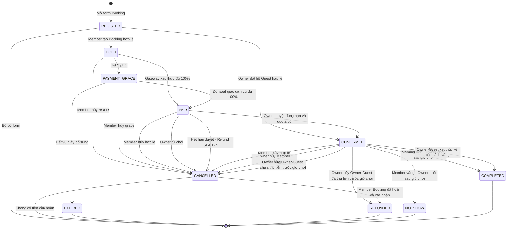

# BOOKING STATE MACHINE — DatSan

**Phiên bản:** 3.0 — 16/11/2026  
**Trạng thái:** Đồng bộ với BRC v3.0 và Role–Permission Matrix v3.0; nhánh nhắc/chuyển Admin quá hạn chốt kết quả ở OPEN-05 chưa được xác nhận hoàn toàn.  
**Cơ sở:** `Booking-State-Machine-DatSan-v2.md` và quyết định OPEN-01…08, OPEN-10 mới nhất.

> **Không đặt cọc:** Member Booking thanh toán đủ **100% hóa đơn bằng chuyển khoản** trước khi đến `PAID`. Owner–Guest Booking có hóa đơn như thường nhưng bỏ qua `HOLD/PAID`, được Owner tạo trực tiếp `REGISTER → CONFIRMED`.

## 1. Các trạng thái

Giữ **10 trạng thái**, dùng `PAYMENT_GRACE` thay tên cũ `LOAD_PAYING`.

| Trạng thái | Ý nghĩa | Chiếm lịch? | Trạng thái cuối? |
|---|---|:---:|:---:|
| `REGISTER` | Nhập/kiểm tra dữ liệu form trước khi tạo Booking; có thể chỉ là bước UI. | Không | Không |
| `HOLD` | Member giữ chỗ, chờ chuyển khoản **100%** trong 5 phút. | **Có** | Không |
| `PAYMENT_GRACE` | Chờ tối đa 90 giây đối soát giao dịch đã mở, không cấp lại QR. | **Có** | Không |
| `PAID` | Đã xác thực Member trả đủ **100%**, đang đợi Owner duyệt. | **Có** | Không |
| `CONFIRMED` | Owner đã duyệt Member Booking hoặc trực tiếp tạo Owner–Guest Booking. | **Có** | Không |
| `EXPIRED` | Hết hạn giữ chỗ, giải phóng Court. | Không | Có |
| `CANCELLED` | Đơn đã hủy và giải phóng Court; Member Booking có thể cần Refund tiếp. | Không | Có điều kiện |
| `REFUNDED` | Đơn đã hoàn tiền; **có thể từ `CANCELLED` hoặc trực tiếp từ `CONFIRMED` của Owner–Guest đã thu tiền**. | Không | Có |
| `NO_SHOW` | Member không đến sau buổi chơi. | Lịch sử đã qua | Có |
| `COMPLETED` | Member đến, hoặc Owner–Guest kết thúc kể cả Guest không đến. | Lịch sử đã qua | Có |

**Bất biến về lịch:** Các trạng thái `HOLD/PAYMENT_GRACE/PAID/CONFIRMED` ngăn đặt trùng. Khi vào `EXPIRED/CANCELLED/REFUNDED`, slot không còn bị Booking đó chiếm. Việc nhả lịch chỉ thực hiện **một lần** (idempotent); `CANCELLED → REFUNDED` không nhả lần hai. `NO_SHOW/COMPLETED` là lịch sử buổi chơi đã qua, không phải slot tương lai để bán lại.

## 2. UML State Machine (Mermaid)



**Lưu ý:** Sơ đồ trạng thái không tự mô tả lịch nhắc Owner hoặc escalation. Đây là tác vụ định thời riêng, không phải Booking status mới. Không có transition thanh toán trễ, theo giả định OPEN-07 rằng sự kiện ấy không xảy ra.

## 3. State Transition Table

| ID | Từ → Đến | Trigger / Actor | Guard (điều kiện) | Action chính |
|---|---|---|---|---|
| T01 | `START → REGISTER` | Member/Owner mở form | Có quyền truy cập tương ứng | Tiếp nhận thông tin, chưa chiếm lịch. |
| T02 | `REGISTER → HOLD` | Member xác nhận tạo | Đúng Court, đủ dữ liệu, Court trống, không blacklist, thời gian 3h–30 ngày; mỗi đơn 1–4h bước 30 phút | Tạo `MEMBER_BOOKING`, ghi `created_at`, khóa slot nguyên tử, mở thanh toán 100%, chạy 5 phút. |
| T03 | `REGISTER → CONFIRMED` | Owner tạo hộ Guest | Đúng Venue, Court trống; đủ thông tin Guest **họ tên/ngày sinh/số điện thoại**, chi tiết Court/giờ/giá/hóa đơn; thời gian hợp lệ | Tạo `OWNER_GUEST_BOOKING`, lập hóa đơn như bình thường, chiếm lịch, không qua HOLD/PAID. |
| T04 | `REGISTER → END` | Người dùng bỏ dở form | Chưa có Booking chính thức | Đóng form/draft, không giải phóng slot vì chưa chiếm. |
| T05 | `HOLD → PAID` | Gateway/Backend | Đúng giao dịch, đủ 100% sau ưu đãi, trong 5 phút | Lưu Payment và `paid_at`, tiếp tục chiếm slot, thông báo Owner. |
| T06 | `HOLD → PAYMENT_GRACE` | Scheduler | Hết 5 phút mà chưa xác nhận đủ 100% | Ẩn QR, không mở giao dịch mới; giữ chỗ thêm 90 giây. |
| T07 | `HOLD → CANCELLED` | Member | Booking vẫn ở HOLD, chưa ghi PAID | Hủy, nhả slot. |
| T08 | `PAYMENT_GRACE → PAID` | Gateway/Backend | **Cùng giao dịch cũ**, đủ 100%, xác thực trong grace | Lưu Payment, dừng đếm thời gian, tiếp tục chiếm Court. |
| T09 | `PAYMENT_GRACE → EXPIRED` | Scheduler | Hết thêm 90 giây mà chưa đủ tiền hợp lệ | Đóng Booking hết hạn, nhả slot. |
| T10 | `PAYMENT_GRACE → CANCELLED` | Member | Chưa ghi PAID, chưa EXPIRED | Hủy, nhả slot. |
| T11 | `PAID → CONFIRMED` | Owner duyệt | Đúng Venue; `now ≤ approval_deadline`; **số Member Booking đang CONFIRMED cùng ngày tạo < 2** | Duyệt và ghi thời điểm; tăng số đếm CONFIRMED atomically. |
| T12 | `PAID → CANCELLED` | Owner từ chối | Owner đúng Venue, Booking vẫn PAID | Nhả Court; hoàn **100% số Member đã chuyển**, **SLA 12h**. |
| T13 | `PAID → CANCELLED` | Member hủy | `now ≤ starts_at − 12h` | Nhả Court; hoàn **100% tiền Member đã chuyển** trong **24h**. |
| T14 | `PAID → CANCELLED` | Scheduler hết hạn duyệt | Đến `min(paid_at+24h, starts_at−2h)`, vẫn PAID | Tự hủy, nhả Court; hoàn **100%** theo **SLA 12h của Owner**. |
| T15 | `CONFIRMED → CANCELLED` | Member hủy | `MEMBER_BOOKING`; `now ≤ starts_at−12h` | Nhả Court, quota CONFIRMED giảm; hoàn **100%** trong **24h**. |
| T16 | `CONFIRMED → CANCELLED` | Owner hủy Member Booking | Đúng Venue, `MEMBER_BOOKING`, trạng thái còn cho phép | Nhả Court, quota CONFIRMED giảm; hoàn **100% số Member đã chuyển**, **SLA 12h**. |
| T17 | `CONFIRMED → NO_SHOW` | Owner chốt | `MEMBER_BOOKING`; Member vắng; `ends_at ≤ now ≤ ends_at + 24h` | Lưu kết quả vắng; phí 30% thực thu. |
| T18 | `CONFIRMED → COMPLETED` | Owner chốt Member | `MEMBER_BOOKING`; Member đến; `ends_at ≤ now ≤ ends_at+24h` | Lưu kết quả thành công; không thu phần tiền còn lại. |
| T19 | `CONFIRMED → COMPLETED` | Owner chốt Guest | `OWNER_GUEST_BOOKING`, buổi chơi kết thúc, còn trong hạn 24h; Guest có thể vắng | Lưu `COMPLETED`, thực thu riêng, Owner tự chịu rủi ro; không `NO_SHOW`. |
| T20 | `CANCELLED → REFUNDED` | Hoàn tiền Member Booking | Đã thực hoàn theo SLA; Owner và Member xác nhận | Chốt Refund, giữ lịch đã giải phóng từ CANCELLED. |
| T21 | `CANCELLED → END` | Hệ thống | Không phát sinh tiền cần hoàn | Kết thúc hủy, không bắt buộc REFUNDED. |
| T22 | `EXPIRED/REFUNDED/NO_SHOW/COMPLETED → END` | Hệ thống | Trạng thái cuối | Lưu audit và lịch sử. |
| **T23** | **`CONFIRMED → REFUNDED`** | **Owner hủy Owner–Guest đã thu tiền** | `OWNER_GUEST_BOOKING`, `now < starts_at`, đã có khoản thu; ghi nhận hoàn trả tương ứng | **Chuyển trực tiếp REFUNDED**, nhả slot ngay, lưu số tiền/biên nhận hoàn; Owner chịu mọi chi phí/rủi ro. |
| **T24** | **`CONFIRMED → CANCELLED`** | **Owner hủy Owner–Guest chưa thu tiền** | `OWNER_GUEST_BOOKING`, `now < starts_at`, không có khoản cần hoàn | Hủy, nhả slot, không mở Refund. |

**Thứ tự ràng buộc:** `now < starts_at` là điều kiện cứng của Owner–Guest; tại đúng `starts_at` Owner **không** còn được hủy. Với Member Booking, Owner không bị mốc 12h ràng buộc nhưng vẫn phải tuân theo các trạng thái hợp lệ. Sau khi đơn `COMPLETED/NO_SHOW` không được sử dụng thao tác hủy thông thường.

**Với T23:** Người dùng đã chốt chuyển trực tiếp `REFUNDED`. Để không tạo trạng thái giả, bản ghi hoàn phải chứng minh nghĩa vụ đã được hoàn tại thời điểm chuyển; nếu chưa hoàn thì chưa thể coi `REFUNDED` là hoàn tất. Đây là điều kiện bảo toàn ngữ nghĩa trạng thái, không bổ sung một bước `CANCELLED` trung gian.

## 4. Guards và invariants

### 4.1. Chống đặt trùng / nhả lịch

- Đang chiếm lịch: `HOLD`, `PAYMENT_GRACE`, `PAID`, `CONFIRMED`.
- Không chiếm lịch: `EXPIRED`, `CANCELLED`, `REFUNDED`.
- Chỉ một Booking đang chiếm lịch được tồn tại cho cùng Court và khoảng giờ giao nhau; việc tạo Booking và khóa chỗ phải nguyên tử.
- `CONFIRMED → REFUNDED` (Owner–Guest đã thu tiền) phải nhả slot **tại chính transition đó**; `CANCELLED → REFUNDED` không nhả lại.
- `COMPLETED/NO_SHOW` được chốt sau `ends_at` nên lịch sử chơi vẫn được lưu, không bán lại khoảng giờ quá khứ.

### 4.2. Giới hạn hai đơn theo ngày tạo — sửa lớn ở v3

```text
confirmed_count(member_id, booking_created_date) =
    COUNT(booking)
    WHERE booking.type = MEMBER_BOOKING
      AND booking.member_id = member_id
      AND booking.status = CONFIRMED
      AND local_date(booking.created_at) = booking_created_date

Precondition PAID -> CONFIRMED: confirmed_count < 2
```

- **Không đếm `PAID`, `CANCELLED`, `REFUNDED`.** Theo cách chốt “chỉ tính confirmed”, không đếm `COMPLETED/NO_SHOW` trong số đếm trạng thái hiện tại.
- `CANCELLED/REFUNDED` sau khi đã duyệt sẽ làm giảm quota; `PAID` chưa duyệt không chiếm quota.
- Vì vậy kiểm soát quota **ở T11** là bắt buộc. T02/T05 có thể kiểm tra sớm để cải thiện UX, nhưng không được thay thế kiểm tra nguyên tử tại T11.
- Nếu quota đã đủ 2 trong lúc một Booking khác vẫn `PAID`, Owner không được duyệt vượt giới hạn. Hành vi chi tiết xử lý/hoàn tiền cho PAID bị từ chối vì quota cần đặc tả trong Use Case exception flow; không tự sửa điều kiện chốt.
- Việc Owner tạo hộ Guest không tiêu hao quota Member vì không phải `MEMBER_BOOKING`.

### 4.3. HOLD và thanh toán 100%

- `hold_deadline = hold_started_at + 5 phút`; `grace_deadline = hold_deadline + 90 giây`.
- Trong grace không phát QR mới và không tạo giao dịch mới; chỉ đối soát đúng giao dịch cũ.
- Chỉ khoản chuyển **đủ 100% `booking_total`** được DatSan xác nhận mới chuyển `PAID`.
- Khoản đặt cọc/tiền mặt còn thiếu không tồn tại trong nghiệp vụ Member Booking.
- **Giả định phạm vi OPEN-07:** tiền đến sau `EXPIRED/CANCELLED` không xảy ra; sơ đồ không có nhánh thanh toán trễ.

### 4.4. Deadlines và Refund

| Tên | Công thức | Hệ quả |
|---|---|---|
| `booking_window` | `3h ≤ starts_at − created_at ≤ 30 ngày` | Cho phép tạo Booking. |
| `approval_deadline` | `min(paid_at+24h, starts_at−2h)` | Hết hạn mà còn PAID → CANCELLED, Refund 12h. |
| `member_cancel_deadline` | `starts_at−12h` | Member hủy hợp lệ, Refund 100% tiền chuyển, SLA 24h. |
| `owner_guest_cancel_cutoff` | `now < starts_at` | Owner–Guest không được hủy khi buổi chơi đã bắt đầu. |
| `owner_refund_deadline` | `cancelled_at+12h` | Owner từ chối/hủy Member Booking hoặc tự hủy quá hạn duyệt. |
| `member_refund_deadline` | `cancelled_at+24h` | Member chủ động hủy hợp lệ. |
| `admin_resolution_deadline` | `escalated_at+48h` | Admin xử lý vụ Refund quá hạn. |
| `result_deadline` | `ends_at+24h` | Owner phải chốt kết quả. |

- Với Member Booking hoàn sau `CANCELLED`, Owner và Member cùng xác nhận thì mới vào `REFUNDED`.
- Với Owner–Guest đã thu tiền, Owner hủy trước giờ chơi và chuyển **trực tiếp** `CONFIRMED → REFUNDED`. Guest không cần tài khoản để xác nhận Member-style Refund; Owner gánh mọi trách nhiệm hoàn trả.
- Tiền Owner thực nhận phải tách khỏi trạng thái Booking để tính hoa hồng; đơn Owner–Guest vẫn có hóa đơn bình thường ngay cả khi chưa thu được tiền.

### 4.5. Chốt kết quả và OPEN-05

- Owner chốt `COMPLETED/NO_SHOW` trong cửa sổ `ends_at ≤ now ≤ ends_at + 24h`.
- Member Booking: có mặt → `COMPLETED`; vắng mặt → `NO_SHOW`.
- Owner–Guest Booking: **cả có mặt và vắng mặt đều → `COMPLETED`**, rủi ro thuộc Owner.
- **Đề xuất, chưa xác nhận hoàn toàn:** nhắc Owner trong 24h sau `ends_at`; đến `ends_at+24h` chưa chốt thì gửi vụ việc sang Admin. Không cho Admin tự động chốt trạng thái nếu chưa có quyết định phân quyền riêng.
- Nhắc và escalation là **event/notification**, không thêm Booking status.

## 5. Tác nhân và trách nhiệm

| Tác nhân | Trách nhiệm |
|---|---|
| Guest | Cung cấp họ tên, ngày sinh, số điện thoại cho Owner khi đặt hộ; không tự sử dụng chức năng đặt sân. |
| Member | Tạo Booking, chuyển khoản 100%, hủy đúng hạn, xác nhận nhận hoàn. |
| Owner | Kế thừa Member; đặt hộ Guest; duyệt, từ chối, hủy đúng Venue; ghi kết quả và thực thu; hoàn tiền khi có nghĩa vụ. |
| Payment Gateway | Cung cấp kết quả giao dịch/đối soát; không tự chuyển Booking status. |
| DatSan/Scheduler | Enforce guards, khóa/nhả slot, timeout, tự hủy khi quá hạn duyệt; nhắc Owner theo lịch nếu thống nhất. |
| Administrator | Xử lý Refund quá SLA; đề xuất tiếp nhận vụ chốt kết quả quá hạn (OPEN-05), chưa mặc định quyền chốt thay Owner. |

## 6. Acceptance Tests — delta v3

| ID | Kịch bản | Kết quả |
|---|---|---|
| AT-V3-01 | Member chỉ chuyển 40% hóa đơn | Không `PAID`. |
| AT-V3-02 | Member chuyển đủ 100% | `HOLD/GRACE → PAID`. |
| AT-V3-03 | Owner có 2 đơn Member đang CONFIRMED tạo cùng ngày; cố duyệt đơn thứ 3 | Từ chối duyệt vượt hạn mức. |
| AT-V3-04 | Một đơn CONFIRMED bị hủy, chuyển CANCELLED | Nhả lịch và giảm confirmed_count. |
| AT-V3-05 | Booking từng PAID rồi CANCELLED/REFUNDED | Không tính vào quota của ngày tạo. |
| AT-V3-06 | Owner tạo hộ thiếu một trong ba thông tin Guest bắt buộc | Từ chối tạo `CONFIRMED`. |
| AT-V3-07 | Owner tạo hộ Guest đủ thông tin, chưa thu tiền | Có hóa đơn bình thường và `CONFIRMED` ngay. |
| AT-V3-08 | Owner–Guest đã thu tiền hủy trước giờ chơi | `CONFIRMED → REFUNDED`, nhả slot. |
| AT-V3-09 | Owner–Guest chưa thu tiền hủy trước giờ chơi | `CONFIRMED → CANCELLED`, nhả slot. |
| AT-V3-10 | Owner–Guest hủy ở/ sau `starts_at` | Không cho phép. |
| AT-V3-11 | Owner không duyệt Member Booking đúng hạn | Auto CANCELLED; hoàn tiền 100% trong 12h. |
| AT-V3-12 | Member hủy đúng hạn sau khi chuyển 1.000.000đ | Hoàn đủ 1.000.000đ trong 24h. |
| AT-V3-13 | Owner–Guest vắng sau buổi chơi | `COMPLETED`; chỉ tính phí trên số Owner thực thu. |
| AT-V3-14 | Owner không chốt sau 24h | Ghi quá hạn; đề xuất thông báo Admin, **chờ xác nhận OPEN-05**. |
| AT-V3-15 | `CANCELLED → REFUNDED` hoặc `CONFIRMED → REFUNDED` | Mỗi Booking chỉ nhả slot một lần. |

## 7. Delta so với v2 và OPEN còn lại

| Mã | Thay đổi |
|---|---|
| OPEN-01 | Auto `PAID → CANCELLED` vì Owner duyệt trễ: Refund **12h**. |
| OPEN-02 | Member hủy hợp lệ: Refund **100% số đã chuyển**. |
| OPEN-03 | Chỉ đếm Booking status `CONFIRMED` theo ngày tạo; không đếm PAID/CANCELLED/REFUNDED. |
| OPEN-04 | Owner–Guest: họ tên, ngày sinh, số điện thoại Guest bắt buộc. |
| OPEN-05 | Nhắc Owner trong 24h; phần **“quá hạn chuyển Admin?”** vẫn chờ xác nhận. |
| OPEN-06 | Hóa đơn Owner–Guest như bình thường; bỏ bước thanh toán lúc tạo. |
| OPEN-07 | Giả định tiền vào muộn sau EXPIRED/CANCELLED không xảy ra. |
| OPEN-08 | Chỉ hủy Owner–Guest trước giờ bắt đầu. |
| OPEN-09 | Timestamp phân xử callback/timeout sát hạn chưa chốt, là vấn đề tích hợp kỹ thuật. |
| OPEN-10 | Owner–Guest có thu tiền: hủy trực tiếp `CONFIRMED → REFUNDED`, Owner chịu rủi ro. |

**Tài liệu liên quan:** `Business-Rules-Catalog-DatSan-v3.md` · `Role-Permission-Matrix-DatSan-v3.md`.
