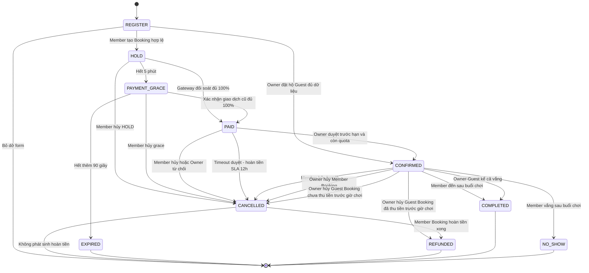

# BUSINESS RULES CATALOG — DatSan

**Phiên bản:** 3.0 — 16/11/2026  
**Trạng thái:** Bản thống nhất sau quyết định OPEN-01…08 và OPEN-10; riêng OPEN-05 có dấu hỏi nên phần chuyển Admin được gắn nhãn **đề xuất chờ xác nhận**.  
**Đồng bộ với:** `Role-Permission-Matrix-DatSan-v3.md`, `Booking-State-Machine-DatSan-v3.md`.  
**Nguồn:** `mo-ta-du-an.md`, BRC v2.0 và những quyết định nghiệp vụ mới nhất của nhóm.

> **Nguyên tắc ưu tiên:** Quyết định mới nhất thay thế tài liệu gốc và v2. Member phải **chuyển khoản đủ 100% giá trị hóa đơn sau ưu đãi**, được Payment Gateway đối soát. **Không có đặt cọc hoặc thanh toán phần còn lại.** Owner tạo Booking hộ Guest vẫn lập hóa đơn như Booking thường, nhưng đi trực tiếp `REGISTER → CONFIRMED` mà không yêu cầu chuyển khoản ở bước tạo.

**Nhãn nguồn:** `[CHỐT]` quyết định người dùng đã xác nhận; `[GỐC]` yêu cầu gốc chưa bị thay thế; `[THIẾT KẾ]` lựa chọn triển khai đề xuất; `[CHỜ XÁC NHẬN]` chưa chốt.

## 1. Tóm tắt chính sách có hiệu lực

| Chủ đề | Chính sách v3.0 |
|---|---|
| Actor | Guest, Member, Owner (Member được cấp thêm quyền), Administrator, Payment Gateway (external). |
| Thanh toán Member | 100% hóa đơn sau ưu đãi bằng chuyển khoản, đối soát đủ mới thành `PAID`; bỏ toàn bộ tiền cọc. |
| Owner–Guest | Owner nhập **họ tên, ngày sinh, số điện thoại** Guest và đầy đủ dữ liệu Booking thông thường; lập hóa đơn như bình thường; `REGISTER → CONFIRMED`, bỏ qua thanh toán lúc tạo. |
| Hạn mức | Tối đa **2 Member Booking đang `CONFIRMED`** trên **một ngày tạo Booking**; không tính `PAID`, `CANCELLED`, `REFUNDED`; diễn giải đúng chữ “chỉ tính CONFIRMED” cũng không tính các trạng thái khác. |
| Giữ lịch | `HOLD`, `PAYMENT_GRACE`, `PAID`, `CONFIRMED` chiếm lịch; `EXPIRED`, `CANCELLED`, `REFUNDED` không chiếm lịch. `REFUNDED` có thể được đi thẳng từ `CONFIRMED` của Owner–Guest đã thu tiền. |
| Đơn vị đặt | Mỗi Booking 1 Court; mỗi đơn 1–4 giờ, bước 30 phút; bỏ tổng giới hạn 4 giờ đặt liên tiếp. |
| Đặt sân | `3h ≤ starts_at − created_at ≤ 30 ngày`. |
| HOLD và grace | 5 phút HOLD; thêm 90 giây PAYMENT_GRACE chỉ đối soát giao dịch cũ, không cấp lại QR hay khởi tạo giao dịch mới. |
| Duyệt | `approval_deadline = min(paid_at + 24h, starts_at − 2h)`; quá hạn `PAID → CANCELLED`, hoàn tiền SLA **12h của Owner**. |
| Member hủy | Từ `PAID/CONFIRMED`, hủy trước `starts_at` ít nhất 12h; **hoàn đúng 100% tiền đã chuyển** trong 24h. |
| Owner hủy Member Booking | Được hủy theo trạng thái hợp lệ không bị mốc 12h ràng buộc; hoàn tiền trong 12h. |
| Owner hủy Owner–Guest | **Chỉ trước khi bắt đầu chơi** (`now < starts_at`); đã thu tiền thì `CONFIRMED → REFUNDED` trực tiếp, Owner tự gánh chi phí và rủi ro; chưa thu tiền thì `CONFIRMED → CANCELLED`. |
| Hoàn tiền quá SLA | Escalate Administrator giải quyết trong 48h kể từ thời điểm escalated_at. |
| Chốt kết quả | Owner chốt trong 24h sau `ends_at`; Owner–Guest vắng vẫn `COMPLETED`. Cơ chế nhắc Owner là mục tiêu; quá hạn chuyển Admin **chờ xác nhận OPEN-05**. |
| Hoa hồng | 30% **tiền Owner thực nhận** của Booking `COMPLETED/NO_SHOW`, tổng hợp theo tháng. |
| Tiền chuyển đến muộn | **Giả định nghiệp vụ không xảy ra** sau `EXPIRED/CANCELLED`; không xây chính sách xử lý chi tiết trong phạm vi BRS hiện tại. |

## 2. Khái niệm và phép tính

| Thuật ngữ | Diễn giải |
|---|---|
| `MEMBER_BOOKING` | Booking Member đặt trực tuyến, bao gồm Owner khi tự đặt sân với quyền Member. |
| `OWNER_GUEST_BOOKING` | Booking Owner tạo hộ Guest tại Venue Owner quản lý; không yêu cầu Guest có tài khoản. |
| `booking_total` | Giá hóa đơn thông thường sau tối đa một mã giảm giá hợp lệ. Có giá trị cả với Owner–Guest dù bỏ qua thanh toán lúc tạo. |
| `created_at` | Thời điểm Booking hình thành: khi `HOLD` (Member) hoặc `CONFIRMED` (Owner–Guest). |
| `paid_at` | Thời điểm hệ thống xác thực đủ 100% tiền Member đã chuyển. |
| `starts_at`, `ends_at` | Thời điểm bắt đầu và kết thúc giờ chơi. |
| `actual_received` | Khoản Owner thực tế đã thu của Booking; **không suy ra từ `booking_total` hay `COMPLETED`**. |
| `cancelled_at`, `escalated_at` | Thời điểm hủy và thời điểm vụ việc được chuyển cho Admin. |
| `confirmed_count(member, D)` | Số `MEMBER_BOOKING` của Member có **status hiện tại = `CONFIRMED`** và **ngày tạo = D**. Ngày lịch đề xuất dùng `Asia/Ho_Chi_Minh`. |
| `approval_deadline` | `min(paid_at + 24 giờ, starts_at − 2 giờ)`. |
| `commission` | `0.30 × actual_received`, chỉ với Booking `COMPLETED/NO_SHOW`; cách tính điều chỉnh sau hoàn và khóa sổ kỳ vẫn là chi tiết tài chính cần đặc tả. |

**Ranh giới về hạn mức:** Theo diễn đạt mới “chỉ tính CONFIRMED”, trạng thái `COMPLETED`/`NO_SHOW` cũng không nằm trong bộ đếm hiện tại. Điều này khác hoàn toàn quy tắc cũ “hai đơn đã thanh toán/ngày”. Nếu nhóm muốn các đơn **đã từng được xác nhận** vẫn chiếm hạn mức sau khi hoàn thành, phải chốt một định nghĩa khác; tài liệu không tự thêm điều kiện ấy.

## 3. Business Rules Catalog

### 3.1. Tài khoản và actor

| ID | Nguồn | Quy tắc |
|---|---|---|
| BR-ACC-01 | [CHỐT] | Owner là Member được Administrator phê duyệt và cấp thêm quyền; không cần tài khoản riêng. |
| BR-ACC-02 | [GỐC] | Mỗi Owner chỉ quản lý tối đa 01 Venue; mỗi Venue có thể có nhiều Court. |
| BR-ACC-03 | [GỐC] | Owner chỉ quản lý Court, Booking, lịch và blacklist thuộc Venue của mình. |
| BR-ACC-04 | [GỐC] | Guest chỉ xem thông tin công khai; không tự đặt sân và không xem cập nhật chi tiết các slot. |
| BR-ACC-05 | [GỐC] | Tài khoản Member không trùng số CCCD hoặc số điện thoại; mỗi tài khoản có mã riêng. |
| BR-ACC-06 | [CHỐT] | Payment Gateway là external actor cung cấp kết quả thanh toán/đối soát; DatSan backend quyết định thay đổi trạng thái. |

### 3.2. Tạo Booking, lịch sân, hạn mức

| ID | Nguồn | Quy tắc |
|---|---|---|
| BR-BKG-01 | [GỐC] | Một Booking chỉ thuộc một Court tại một Venue. |
| BR-BKG-02 | [GỐC] | Bước thời gian 30 phút; mỗi Booking tối thiểu 1h, tối đa 4h. |
| BR-BKG-03 | [CHỐT] | Booking phải được tạo trước `starts_at` từ 3h đến 30 ngày, bao gồm hai biên. |
| BR-BKG-04 | [CHỐT] | Không áp giới hạn tổng thời lượng đặt liên tiếp trên cùng Court. |
| BR-BKG-05 | [CHỐT — SỬA V3] | Hạn mức tối đa **02 `MEMBER_BOOKING` có trạng thái hiện tại `CONFIRMED`**, nhóm theo **ngày tạo Booking** và tài khoản Member. Đơn `PAID` chưa được duyệt không được cộng vào số đếm; `CANCELLED/REFUNDED` không tính. |
| BR-BKG-06 | [GỐC] | Member nằm trong blacklist của Venue không được tự đặt Venue đó cho đến khi được gỡ. |
| BR-BKG-07 | [GỐC] | Mỗi Booking tối đa 1 mã giảm giá hợp lệ; mã đã dùng không hoàn lượt khi Booking hủy. |
| BR-BKG-08 | [CHỐT] | `HOLD`, `PAYMENT_GRACE`, `PAID`, `CONFIRMED` đều chiếm lịch Court. |
| BR-BKG-09 | [CHỐT — SỬA V3] | Slot được giải phóng khi Booking vào **`EXPIRED`, `CANCELLED` hoặc `REFUNDED`**. Với `CANCELLED → REFUNDED`, chỉ giải phóng một lần; với `CONFIRMED → REFUNDED` của Owner–Guest phải giải phóng ngay ở transition đó. |
| BR-BKG-10 | [THIẾT KẾ] | Không cho hai Booking đang chiếm lịch có khoảng thời gian chồng nhau trên cùng Court; kiểm tra và khóa trong một DB transaction. |
| BR-BKG-11 | [CHỐT] | Owner đặt hộ Guest vẫn phải cung cấp dữ liệu đặt sân đầy đủ như form Booking thông thường, ngoại trừ bước thanh toán khi tạo. |
| BR-BKG-12 | [CHỐT] | Owner chỉ đặt hộ Guest tại Venue của mình; `REGISTER → CONFIRMED` ngay khi hợp lệ và khóa lịch. |
| BR-BKG-13 | [CHỐT — MỚI V3] | Trường nhận diện Guest **bắt buộc** khi Owner đặt hộ: **họ tên, ngày sinh, số điện thoại**. Các trường nghiệp vụ thông thường về Court, giờ bắt đầu/kết thúc, giá, ưu đãi/hóa đơn vẫn phải được cung cấp hoặc xác định. |
| BR-BKG-14 | [CHỐT — MỚI V3] | Giới hạn 2 đơn áp cho Member Booking, **không** áp cho Owner–Guest Booking được Owner tạo tại sân mình với quyền Owner. Chỉ số `confirmed_count` phải được kiểm tra trước khi duyệt Member Booking và cập nhật nguyên tử. |

**Ghi chú thực thi:** Vì `PAID` không còn chiếm hạn mức nhưng `CONFIRMED` có chiếm hạn mức, backend phải xử lý trường hợp nhiều Booking `PAID` cùng chờ Owner duyệt. Hệ thống **không được duyệt vượt hạn mức**. Quy trình từ chối/hoàn tiền với một đơn đã PAID nhưng không đủ hạn mức xác nhận cần được mô tả trong Use Case/Payment Exceptions, không mặc nhiên coi đây là lỗi của Member.

### 3.3. HOLD, PAYMENT_GRACE và chuyển khoản

| ID | Nguồn | Quy tắc |
|---|---|---|
| BR-PAY-01 | [GỐC] | `REGISTER → HOLD` tạo giữ chỗ trong 5 phút kể từ `hold_started_at`. |
| BR-PAY-02 | [CHỐT] | Hết 5 phút chưa có xác nhận đủ 100% → `PAYMENT_GRACE` thêm 90 giây, vẫn chiếm lịch. |
| BR-PAY-03 | [CHỐT] | Trong grace không cấp lại QR, không khởi tạo thanh toán mới; chỉ chờ kết quả giao dịch đã khởi tạo. |
| BR-PAY-04 | [CHỐT] | Hết grace chưa xác nhận thanh toán → `EXPIRED`; thời gian HOLD + grace tối đa 6 phút 30 giây. |
| BR-PAY-05 | [CHỐT] | Member phải chuyển khoản **đủ 100%** hóa đơn sau ưu đãi và được đối soát mới vào `PAID`. |
| BR-PAY-06 | [CHỐT] | Loại bỏ hoàn toàn tiền cọc, trả một phần và thu phần còn lại bằng tiền mặt trong Member Booking. |
| BR-PAY-07 | [GỐC] | Tiền chuyển thẳng cho Owner; DatSan ghi nhận và đối soát, không mặc định giữ hộ tiền. |
| BR-PAY-08 | [CHỐT] | `PAID` của Member Booking xác nhận đã thanh toán đủ 100%, `CONFIRMED` không phát sinh phần tiền còn thiếu. |
| BR-PAY-09 | [CHỐT — SỬA V3] | **Giả định phạm vi**: thanh toán chuyển khoản đến sau `EXPIRED/CANCELLED` không xảy ra. Không xây SLA hoặc chuyển trạng thái riêng cho sự kiện này trong phạm vi nghiệp vụ hiện tại. |
| BR-PAY-10 | [CHỐT] | Owner–Guest Booking không đi qua `HOLD/PAID`, Owner theo dõi số tiền thực nhận để tính phí. |
| BR-PAY-11 | [CHỐT — MỚI V3] | Owner–Guest Booking **vẫn tạo hóa đơn với giá và quy tắc tính như Booking bình thường**; chỉ **bỏ qua yêu cầu thanh toán lúc tạo**, không miễn phí hoặc tự đánh dấu đã trả. |

> **Giới hạn giả định BR-PAY-09:** Việc giả định “không xảy ra” không phải cơ chế kỹ thuật ngăn tiền về muộn. Nếu triển khai thực tế, nhóm cần xác định cách đối soát callback muộn, nhưng không được tự thay đổi các quyết định nghiệp vụ đang chốt.

### 3.4. Duyệt đơn

| ID | Nguồn | Quy tắc |
|---|---|---|
| BR-APR-01 | [CHỐT] | Owner duyệt đơn Member đang `PAID` tối đa 24h sau `paid_at` và muộn nhất 2h trước `starts_at`; dùng hạn sớm hơn. |
| BR-APR-02 | [CHỐT] | `approval_deadline = min(paid_at + 24h, starts_at − 2h)`, chỉ Owner đúng Venue được duyệt. |
| BR-APR-03 | [CHỐT] | Quá hạn duyệt nếu vẫn `PAID` → hệ thống tự `PAID → CANCELLED`, giải phóng lịch, mở hồ sơ Refund. |
| BR-APR-04 | [GỐC] | Owner có thể từ chối `PAID` thuộc Venue mình, phải lưu lý do và hoàn tiền. |
| BR-APR-05 | [GỐC] | Sau khi thanh toán, Member không được sửa trực tiếp giờ chơi; muốn đổi phải tạo đơn mới. |
| BR-APR-06 | [CHỐT — MỚI V3] | `PAID → CANCELLED` **do quá hạn Owner duyệt** áp SLA hoàn tiền **12 giờ của Owner**, tính từ `cancelled_at`. |

### 3.5. Hủy và hoàn tiền

| ID | Nguồn | Quy tắc |
|---|---|---|
| BR-CAN-01 | [CHỐT] | Member hủy `PAID/CONFIRMED` hợp lệ khi `now ≤ starts_at − 12h`. |
| BR-CAN-02 | [CHỐT] | Owner được hủy/từ chối Member Booking tại Venue mình theo các trạng thái hợp lệ, không bị giới hạn 12h. |
| BR-CAN-03 | [GỐC] | Member hủy `HOLD/PAYMENT_GRACE` khi chưa `PAID` → `CANCELLED`, nhả lịch, không cần Refund. |
| BR-CAN-04 | [CHỐT — SỬA V3] | Booking vào `CANCELLED` **hoặc `REFUNDED` trực tiếp** phải giải phóng lịch; nếu có nghĩa vụ trả tiền mà chưa hoàn thì lưu quy trình Refund theo loại Booking. |
| BR-CAN-05 | [CHỐT — MỚI V3] | Owner chỉ được hủy `OWNER_GUEST_BOOKING` khi **`now < starts_at`**; từ lúc bắt đầu buổi chơi không được hủy. |
| BR-CAN-06 | [CHỐT — MỚI V3] | Owner hủy `OWNER_GUEST_BOOKING`: **đã thu tiền** thì chuyển trực tiếp `CONFIRMED → REFUNDED` và Owner chịu mọi chi phí/rủi ro; **chưa thu tiền** thì `CONFIRMED → CANCELLED`. |
| BR-REF-01 | [CHỐT — SỬA V3] | Member hủy hợp lệ trước ít nhất 12h → được hoàn **100% số tiền thực chuyển**, thời hạn hoàn **24h** kể từ `cancelled_at`. |
| BR-REF-02 | [CHỐT] | Owner từ chối/hủy Member Booking → hoàn **100% số tiền Member đã chuyển** trong **12h** kể từ `cancelled_at`. |
| BR-REF-03 | [CHỐT] | Quá SLA hoàn tiền thì chuyển Administrator; Admin giải quyết trong 48h kể từ `escalated_at`. |
| BR-REF-04 | [CHỐT/GỐC] | Member Booking đã `CANCELLED` chỉ chuyển `REFUNDED` khi tiền thực hoàn và Owner + Member xác nhận; với Member hủy hợp lệ, số tiền hoàn luôn 100% số đã chuyển. |
| BR-REF-05 | [THIẾT KẾ] | Tiến độ, chứng từ và người xác nhận hoàn được lưu riêng ở Refund, không lạm dụng Booking status. |
| BR-REF-06 | [CHỐT — MỚI V3] | Với Owner–Guest **đã thu tiền** và Owner hủy trước `starts_at`, không bắt buộc Guest có tài khoản Member để xác nhận Refund; trạng thái Booking chuyển trực tiếp `REFUNDED`, Owner chịu nghĩa vụ hoàn và chi phí liên quan. |

**Lưu ý tính nhất quán:** `REFUNDED` có nghĩa đã hoàn tiền; vì vậy khi hiện thực hóa **nhánh chuyển trực tiếp** cần lưu được giao dịch/biên nhận hoặc xác nhận khoản đã hoàn tại thời điểm chuyển trạng thái. Việc chỉ bấm “hủy” khi chưa hoàn thực tế nhưng đã ghi `REFUNDED` sẽ làm mất ý nghĩa trạng thái. Đây là ràng buộc thiết kế đề xuất để giữ tính đúng đắn, không sửa quyết định Owner chịu toàn bộ rủi ro.

### 3.6. Chốt kết quả, phí hoa hồng

| ID | Nguồn | Quy tắc |
|---|---|---|
| BR-END-01 | [CHỐT] | Owner chốt `COMPLETED/NO_SHOW` trong 24h kể từ `ends_at`. |
| BR-END-02 | [CHỐT] | Member đến chơi thì Owner ghi `COMPLETED`; hóa đơn Member đã chuyển đủ 100% trước đó. |
| BR-END-03 | [GỐC] | Member không đến được chốt `NO_SHOW`; Owner giữ số tiền đã nhận, không phải bồi hoàn chỉ vì vắng. |
| BR-END-04 | [CHỐT] | Owner–Guest đến hay vắng vẫn chốt `COMPLETED` sau khi hết giờ, Owner tự chịu rủi ro không đến/không trả tiền. |
| BR-END-05 | [CHỐT] | Nền tảng thu **30% số tiền Owner thực nhận** cho Booking `COMPLETED/NO_SHOW`. |
| BR-END-06 | [GỐC] | Nền tảng tổng hợp phí theo tháng, yêu cầu Owner nộp lại. |
| BR-END-07 | [CHỐT/DIỄN GIẢI] | Owner–Guest `COMPLETED` nhưng thực thu 0 đồng → hoa hồng 0 đồng; số tiền hóa đơn không mặc định là thực thu. |
| BR-END-08 | [GỐC] | Member có Booking `COMPLETED` được đánh giá 1–5 sao và phản hồi. |
| BR-END-09 | [CHỜ XÁC NHẬN — OPEN-05] | Hệ thống **nhắc Owner trong cửa sổ 24h sau `ends_at`**. Nếu chưa chốt ở `ends_at + 24h`, **đề xuất** chuyển vụ việc cho Admin; không tự kết luận `COMPLETED`/`NO_SHOW` và không tự đổi trạng thái Booking. |

### 3.7. Quản lý Venue, nội dung

| ID | Nguồn | Quy tắc |
|---|---|---|
| BR-VEN-01 | [GỐC] | Owner được quản lý Court, giá, lịch bảo trì và ẩn sân thuộc Venue mình. |
| BR-VEN-02 | [GỐC] | Mã giảm giá và thông báo/khuyến mãi Owner gửi phải được Admin duyệt trước khi áp dụng. |
| BR-VEN-03 | [GỐC] | Thông báo được duyệt hiển thị trên website tối đa 3 tháng. |
| BR-VEN-04 | [GỐC] | Owner quản lý blacklist của Venue mình và lưu lý do, mã đơn, thông tin nợ (nếu có). |
| BR-VEN-05 | [GỐC] | Member gửi báo cáo/khiếu nại kèm chứng cứ ảnh/PDF; Admin xử lý. |

## 4. Sơ đồ vòng đời Booking chuẩn v3

`CONFIRMED → REFUNDED` áp dụng **riêng** cho Owner–Guest đã thu tiền; đây là điểm khác v2. `REFUNDED` là trạng thái giải phóng slot ngay nếu đi thẳng từ `CONFIRMED`. Những đơn `CANCELLED → REFUNDED` đã nhả lịch từ lúc `CANCELLED`.

## 5. Timeline và SLA

| Mốc | Công thức / điều kiện |
|---|---|
| Cửa sổ tạo Booking | `3h ≤ starts_at - created_at ≤ 30 ngày` |
| HOLD | `hold_started_at + 5 phút` |
| PAYMENT_GRACE | `hold_started_at + 6 phút 30 giây` |
| Owner duyệt Member Booking | `min(paid_at + 24h, starts_at - 2h)` |
| Member hủy | `now ≤ starts_at - 12h` |
| Owner hủy Owner–Guest | `now < starts_at` |
| Refund Member hủy | `cancelled_at + 24h`, hoàn 100% khoản đã chuyển |
| Refund Owner từ chối/hủy Member Booking | `cancelled_at + 12h`; hoàn 100% số đã chuyển |
| Refund tự hủy do Owner duyệt quá hạn | `cancelled_at + 12h` |
| Escalation Admin | `escalated_at + 48h` |
| Owner chốt kết quả | `ends_at + 24h` |
| Nhắc Owner / escalation quá hạn chốt | Nhắc trong 24h sau `ends_at`; đề xuất Admin nhận việc khi quá hạn — **OPEN-05 chờ xác nhận** |

## 6. Acceptance Tests ưu tiên

| ID | Kịch bản | Kết quả |
|---|---|---|
| AT-01 | Member chuyển 40% hoặc 99% hóa đơn | Không chuyển `PAID`; không có cọc. |
| AT-02 | Member chuyển đủ 100%, Gateway xác thực khi HOLD/grace còn hiệu lực | Chuyển `PAID` chính xác một lần. |
| AT-03 | Grace 90 giây | Không có QR/giao dịch mới; chỉ đối soát giao dịch cũ. |
| AT-04 | Chủ sân đặt Guest thiếu họ tên/ngày sinh/số điện thoại | Không tạo `CONFIRMED`. |
| AT-05 | Chủ sân đặt hộ Guest đủ thông tin, chưa thu tiền | Vẫn có hóa đơn; `REGISTER → CONFIRMED`, ghi thực nhận 0, chiếm lịch. |
| AT-06 | Guest không đến buổi chơi | Owner chốt `COMPLETED`, tự chịu rủi ro; phí 30% khoản thực thu. |
| AT-07 | Member hủy trước đúng 12h khi đã PAID 1.000.000đ | `CANCELLED`, nghĩa vụ hoàn 1.000.000đ trong 24h. |
| AT-08 | Timeout Owner duyệt tại `approval_deadline` | `PAID → CANCELLED`, nhả lịch, hoàn 100% trong 12h. |
| AT-09 | Member Booking PAID rồi hủy/được hoàn | Không còn tính vào quota CONFIRMED của ngày tạo. |
| AT-10 | Member có 2 CONFIRMED tạo cùng ngày, có thêm PAID đang chờ duyệt | Không duyệt PAID thứ ba thành CONFIRMED khi quota vẫn đủ 2. |
| AT-11 | Member đã có 2 CONFIRMED, một đơn thành CANCELLED | `confirmed_count` giảm còn 1; có thể duyệt thêm một đơn nếu các guard khác đúng. |
| AT-12 | Owner–Guest chưa thu tiền hủy trước giờ chơi | `CONFIRMED → CANCELLED`, nhả slot. |
| AT-13 | Owner–Guest đã thu tiền hủy trước giờ chơi | `CONFIRMED → REFUNDED` trực tiếp, lưu nghĩa vụ/chứng cứ hoàn, nhả slot. |
| AT-14 | Owner–Guest muốn hủy đúng khi `now = starts_at` | Từ chối hủy; không cho chuyển `CANCELLED/REFUNDED`. |
| AT-15 | `CONFIRMED → REFUNDED` | Giải phóng slot ngay; không cần ghé `CANCELLED`. |
| AT-16 | Owner chưa chốt ở `ends_at + 24h` | Ghi quá hạn, không tự đoán kết quả; **đề xuất** escalate Admin, chờ xác nhận. |
| AT-17 | Khoản chuyển sau EXPIRED/CANCELLED | Ngoài phạm vi test BRS theo giả định OPEN-07; không có luồng chuyển trạng thái mới. |
| AT-18 | Refund Owner hoặc timeout duyệt quá 12h | Chuyển Admin; Admin xử lý trong 48h từ escalation. |

## 7. Tình trạng các OPEN từ v2

| ID | Kết luận | Trạng thái |
|---|---|---|
| OPEN-01 | Timeout duyệt: SLA Refund **12h của Owner**. | **ĐÃ CHỐT** |
| OPEN-02 | Member hủy hợp lệ ≥12h: hoàn **100% số tiền đã chuyển**. | **ĐÃ CHỐT** |
| OPEN-03 | Chỉ đếm Booking status **CONFIRMED** theo ngày tạo, CANCELLED/REFUNDED không tính. | **ĐÃ CHỐT** |
| OPEN-04 | Owner nhập Guest **họ tên, ngày sinh, số điện thoại**, cùng đủ dữ liệu Booking. | **ĐÃ CHỐT** |
| OPEN-05 | Nhắc Owner trong 24h sau `ends_at`; “quá hạn chuyển Admin?” nêu ở dạng câu hỏi. | **CHỜ XÁC NHẬN PHẦN ESCALATION** |
| OPEN-06 | Owner–Guest có hóa đơn như thường; bỏ qua bước thanh toán khi tạo. | **ĐÃ CHỐT** về hóa đơn; cách xác minh thực thu/điều chỉnh hóa đơn tháng vẫn là chi tiết kỹ thuật/tài chính. |
| OPEN-07 | Giả định tiền chuyển đến muộn sau EXPIRED/CANCELLED **không xảy ra**. | **ĐÃ CHỐT (GIẢ ĐỊNH)** |
| OPEN-08 | Owner chỉ được hủy Owner–Guest trước `starts_at`. | **ĐÃ CHỐT** |
| OPEN-09 | Cách phân xử timestamp đối soát sát deadline (`gateway_paid_at` hay server nhận). | **CHƯA CHỐT — KỸ THUẬT** |
| OPEN-10 | Owner–Guest đã thu tiền, Owner hủy → `CONFIRMED → REFUNDED` trực tiếp; Owner chịu rủi ro. | **ĐÃ CHỐT** |

### Chi tiết nên để trong Use Case Specification / thiết kế kỹ thuật

1. Khi có nhiều Member Booking đang `PAID` nhưng hạn mức `CONFIRMED` chỉ còn 1, thiết kế thao tác duyệt nguyên tử và quy trình từ chối/hoàn nếu quota đã đầy.
2. Về OPEN-05, cần xác nhận Admin chỉ **nhận vụ việc** hay có quyền **chốt kết quả thay Owner**. Trong v3 Admin không được cấp quyền chốt thay.
3. Về Owner–Guest, trường tiền thu/tiền hoàn, chứng từ và cách điều chỉnh hóa đơn hoa hồng tháng cần được thiết kế riêng, không thể suy ra từ `COMPLETED/REFUNDED`.

## 8. Traceability

| Nhóm | BRC | State Machine | Role Matrix |
|---|---|---|---|
| 100% thanh toán Member | BR-PAY-05/06/08 | Luồng HOLD/GRACE → PAID | Phân quyền thanh toán |
| Hạn mức CONFIRMED | BR-BKG-05/14 | Guard `PAID → CONFIRMED` | Quyền duyệt Owner |
| Owner–Guest và hóa đơn | BR-BKG-11/13, BR-PAY-11 | REGISTER → CONFIRMED | Quyền tạo hộ |
| Hủy Owner–Guest đã thu tiền | BR-CAN-05/06, BR-REF-06 | CONFIRMED → REFUNDED | Quyền hủy Owner |
| Refund timeout 12h | BR-APR-06 | PAID → CANCELLED + Refund SLA | Admin nhận vụ việc quá hạn |
| Nhắc/kết quả quá hạn | BR-END-09 (đề xuất) | Không tự đổi trạng thái | Admin tiếp nhận theo đề xuất |

---

**Tài liệu đồng bộ v3:** `Booking-State-Machine-DatSan-v3.md` · `Role-Permission-Matrix-DatSan-v3.md`.
