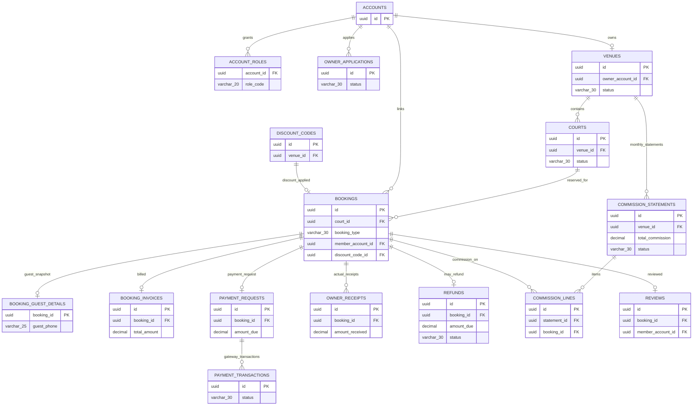
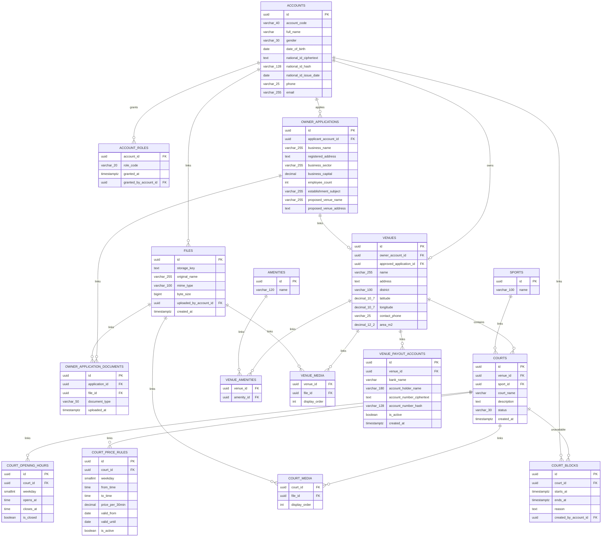
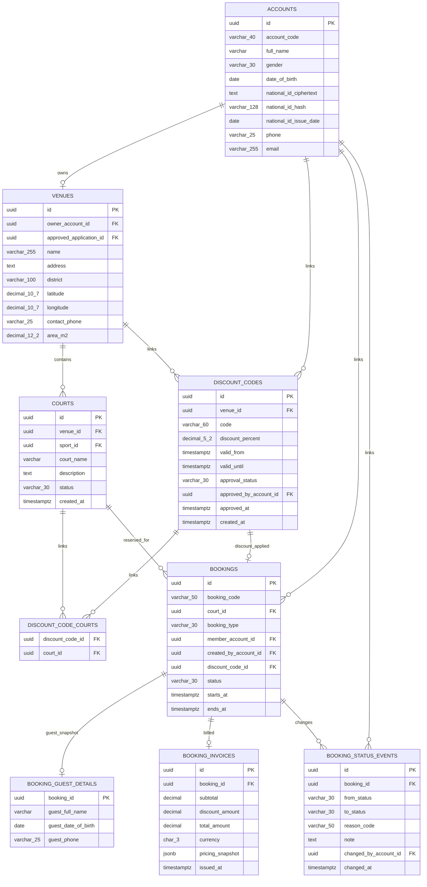
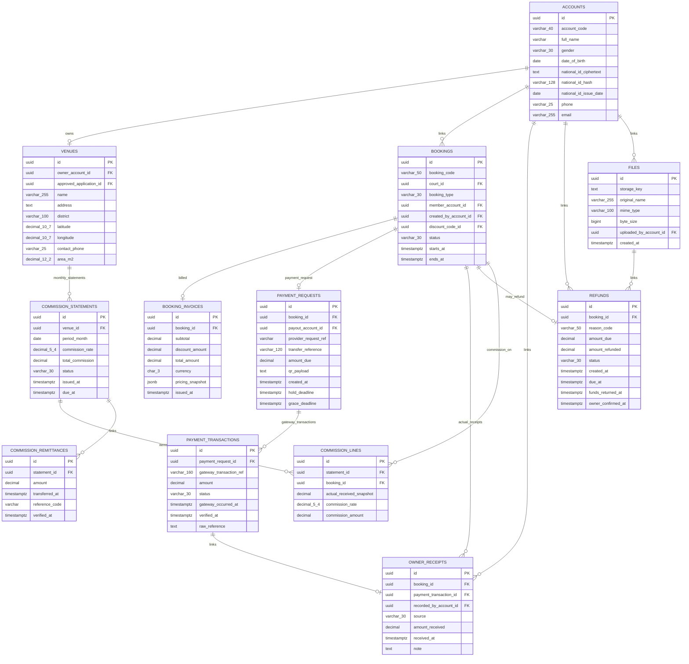
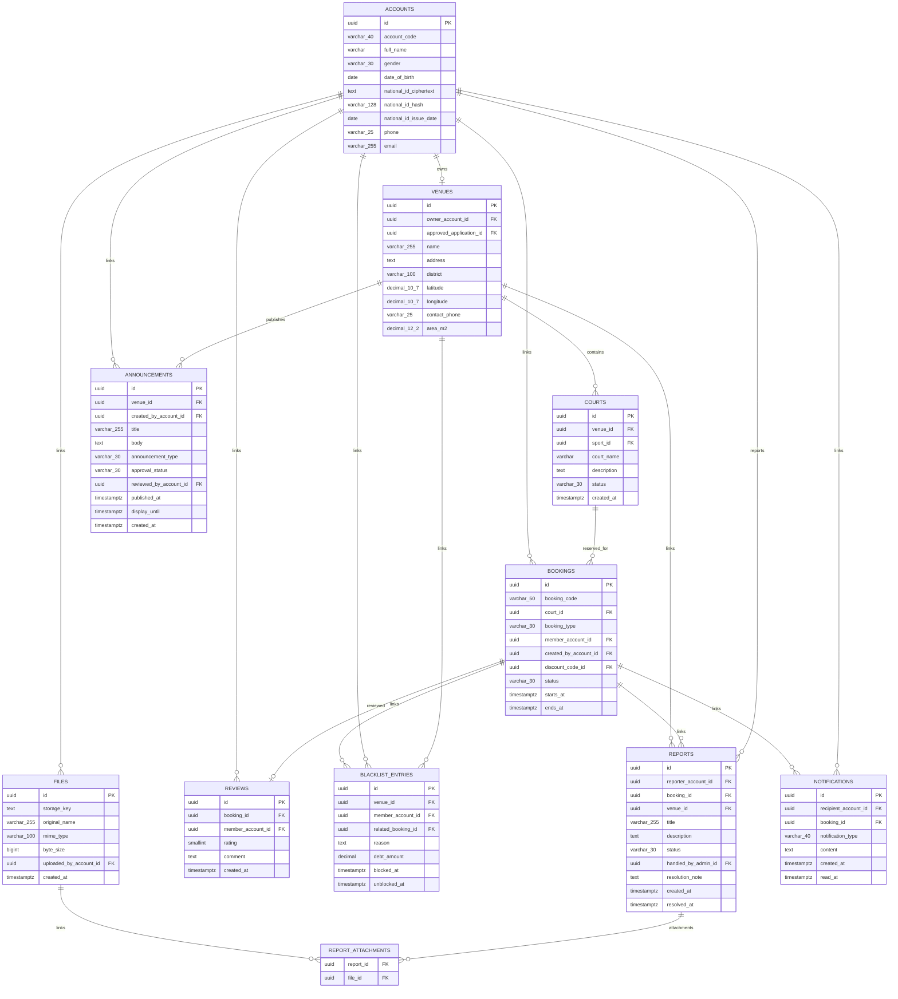

# ERD DAT SAN — THIẾT KẾ DỮ LIỆU LOGIC

**Phiên bản:** 1.1 — bổ sung chú thích đầy đủ · **Ngày:** 16/11/2026  
**Phạm vi:** Toàn hệ thống DatSan (21 Use Case tổng quan + Booking & Payment).  
**Nguồn đối chiếu:** `mo-ta-du-an.md`, `Business-Rules-Catalog-DatSan-v3.md`, `Role-Permission-Matrix-DatSan-v3.md`, `Booking-State-Machine-DatSan-v3.md`, `Use-Case-Specification-DatSan-v3.md`.

> **Phân biệt nguồn:** Những chính sách đặt sân, thanh toán, hoàn tiền, phân quyền và phí đã được chốt trong tài liệu nguồn. Việc lựa chọn tên bảng, kiểu dữ liệu, khóa, bảng trung gian, index và PostgreSQL trong ERD là **[THIẾT KẾ ĐỀ XUẤT]**, chưa phải quy định nghiệp vụ đã được phê duyệt.

## 1. Tổng quan kiến trúc dữ liệu

ERD logic gồm **35 bảng**, chia thành **5 miền dữ liệu**. Đặt tên bảng và cột bằng tiếng Anh để thuận lợi cho backend. FK trong các bảng chỉ nói quan hệ dữ liệu; quyền thao tác phải được kiểm tra thêm trong service/API.

| Miền | Số bảng | Nội dung |
|---|---:|---|
| Identity & Owner | 5 | Account, vai trò, hồ sơ Owner, chứng từ |
| Venue & Court | 11 | Địa điểm, sân, lịch, giá, tiện ích, ảnh |
| Booking & Offers | 6 | Đơn, khách đặt hộ, hóa đơn, ưu đãi, log trạng thái |
| Finance | 7 | QR/transfer, tiền thực thu, hoàn tiền, hoa hồng tháng |
| Content & Operations | 6 | Đánh giá, blacklist, thông báo, báo cáo, nhắc việc |

**Các quy tắc bắt buộc được mô hình hóa:**

- **Owner là Member được cấp thêm quyền**: `accounts` và `account_roles`; không tạo bảng Owner Login riêng. `venues.owner_account_id` unique để tối đa 1 địa điểm/Owner.
- **1 Venue – nhiều Court; 1 Booking – 1 Court**: `courts.venue_id` và `bookings.court_id`.
- **Hai loại đơn**: `MEMBER_BOOKING` có `member_account_id`; `OWNER_GUEST_BOOKING` có một dòng `booking_guest_details` (họ tên, ngày sinh, điện thoại); cả hai phải có `booking_invoices`.
- **Member trả đủ 100% qua chuyển khoản**: `payment_requests` gắn tài khoản nhận tiền `venue_payout_accounts` và `payment_transactions`; Owner–Guest **không** có yêu cầu thanh toán lúc tạo, nhưng có thể có `owner_receipts` (tiền thực thu).
- **Tách Booking, Invoice, Payment, Receipt, Refund**: trạng thái `PAID` không được đồng nhất với Owner thực thu của Owner–Guest; hoa hồng 30% dùng **tiền thực nhận**, không dùng tổng hóa đơn.
- **REGISTER là bước điền form** trong State Machine; bản thiết kế **không lưu Booking ở trạng thái REGISTER** khi chưa xác nhận. Member tạo bản ghi ở HOLD; Owner–Guest tạo bản ghi ở CONFIRMED. Nếu cần lưu draft, phải bổ sung chính sách và bảng nháp.
- **HOLD/PAYMENT_GRACE/PAID/CONFIRMED chiếm sân**; `EXPIRED/CANCELLED/REFUNDED` giải phóng. `CONFIRMED → REFUNDED` trực tiếp chỉ áp dụng Owner–Guest đã thực hoàn.
- **Hạn mức hiện hành**: tối đa 2 `MEMBER_BOOKING` có status **hiện tại** là `CONFIRMED`, nhóm theo account và **ngày tạo**. `PAID`, `COMPLETED`, `NO_SHOW`, `CANCELLED`, `REFUNDED` không tính.

### 1.1. Bảng tra cứu nhanh 35 thực thể

Bảng này giúp đọc các tên tiếng Anh xuất hiện trong Mermaid/DBML. Mỗi thực thể được giải thích chi tiết tại Mục 3.

| Nhóm nghiệp vụ | Thực thể | Ý nghĩa |
|---|---|---|
| Tài khoản & Owner | `accounts` | Tài khoản người dùng đã đăng ký |
| Tài khoản & Owner | `account_roles` | Danh sách vai trò gán cho tài khoản |
| Tài khoản & Owner | `owner_applications` | Hồ sơ xin quyền Owner |
| Tài khoản & Owner | `files` | Metadata của tệp đính kèm dùng chung |
| Tài khoản & Owner | `owner_application_documents` | Liên kết hồ sơ Owner và giấy tờ |
| Địa điểm & Sân | `venues` | Địa điểm thể thao của Owner |
| Địa điểm & Sân | `venue_payout_accounts` | Tài khoản ngân hàng của địa điểm |
| Địa điểm & Sân | `sports` | Danh mục môn thể thao |
| Địa điểm & Sân | `courts` | Sân con thuộc địa điểm |
| Địa điểm & Sân | `court_opening_hours` | Giờ hoạt động định kỳ theo tuần |
| Địa điểm & Sân | `court_price_rules` | Quy tắc giá theo khung giờ |
| Địa điểm & Sân | `court_blocks` | Khoảng sân tạm ngừng cho đặt |
| Địa điểm & Sân | `amenities` | Danh mục tiện ích |
| Địa điểm & Sân | `venue_amenities` | Liên kết Venue và tiện ích |
| Địa điểm & Sân | `venue_media` | Ảnh/tệp giới thiệu địa điểm |
| Địa điểm & Sân | `court_media` | Ảnh/tệp giới thiệu sân con |
| Đặt sân & Ưu đãi | `discount_codes` | Mã khuyến mãi |
| Đặt sân & Ưu đãi | `discount_code_courts` | Danh sách sân áp dụng mã |
| Đặt sân & Ưu đãi | `bookings` | Đơn đặt sân, trạng thái hiện tại |
| Đặt sân & Ưu đãi | `booking_guest_details` | Thông tin Guest do Owner đặt hộ |
| Đặt sân & Ưu đãi | `booking_invoices` | Hóa đơn tính tiền đơn |
| Đặt sân & Ưu đãi | `booking_status_events` | Lịch sử thay đổi trạng thái đơn |
| Thanh toán & Hoa hồng | `payment_requests` | Yêu cầu thanh toán 100%/QR |
| Thanh toán & Hoa hồng | `payment_transactions` | Bản ghi giao dịch cổng thanh toán |
| Thanh toán & Hoa hồng | `owner_receipts` | Sổ tiền Owner thực nhận |
| Thanh toán & Hoa hồng | `refunds` | Nghĩa vụ và tiến độ hoàn tiền |
| Thanh toán & Hoa hồng | `commission_statements` | Bảng kê hoa hồng theo kỳ |
| Thanh toán & Hoa hồng | `commission_lines` | Chi tiết phí của mỗi đơn |
| Thanh toán & Hoa hồng | `commission_remittances` | Chuyển khoản phí Owner nộp nền tảng |
| Nội dung & Vận hành | `reviews` | Đánh giá sau khi chơi |
| Nội dung & Vận hành | `blacklist_entries` | Danh sách thành viên bị chặn theo Venue |
| Nội dung & Vận hành | `announcements` | Thông báo và khuyến mãi công khai |
| Nội dung & Vận hành | `reports` | Báo cáo/khiếu nại |
| Nội dung & Vận hành | `report_attachments` | Liên kết chứng cứ và báo cáo |
| Nội dung & Vận hành | `notifications` | Thông báo riêng và nhắc việc |

### 1.2. Chú thích ký hiệu và kiểu dữ liệu

| Ký hiệu / kiểu | Giải thích | Ví dụ trong DatSan |
|---|---|---|
| **PK** | Khóa chính, nhận diện duy nhất một bản ghi | `bookings.id` |
| **FK** | Khóa ngoại tham chiếu khóa của bảng khác | `bookings.court_id → courts.id` |
| **NN / NOT NULL** | Bắt buộc có giá trị tại database | `bookings.court_id` |
| **UQ / UNIQUE** | Giá trị hoặc tổ hợp giá trị không được trùng theo ràng buộc | `accounts.account_code` |
| **NULL / dấu —** | Có thể để trống nếu không có ràng buộc NOT NULL; tùy ngữ cảnh nghiệp vụ | `refunds.proof_file_id` |
| **PK tổng hợp** | Một cặp nhiều cột cùng làm khóa chính | `(venue_id, amenity_id)` |
| `uuid` | Mã định danh toàn cục, không mang ý nghĩa nghiệp vụ trực tiếp | `bookings.id` |
| `varchar(n)` / `text` | Chuỗi giới hạn độ dài / chuỗi văn bản dài | tên sân / mô tả sân |
| `decimal(p,s)` | Số thập phân chính xác; thích hợp cho tiền và tỷ lệ | `amount_due`, `commission_rate` |
| `int` / `smallint` / `bigint` | Số nguyên với dải lưu trữ khác nhau | `employee_count`, `weekday`, `byte_size` |
| `boolean` | Giá trị đúng/sai | `is_active` |
| `date` / `time` | Chỉ ngày / chỉ giờ trong ngày | `date_of_birth`, `opens_at` |
| `timestamptz` | Thời điểm có thông tin múi giờ | `starts_at`, `created_at` |
| `jsonb` | Bản chụp dữ liệu JSON có cấu trúc, dùng khi cần giữ lịch sử giá | `pricing_snapshot` |
| `||` / `o|` / `o{` | Chính xác một / không hoặc một / không hoặc nhiều (cardinality) | `VENUES ||--o{ COURTS` |

**Lưu ý:** Tên mã trạng thái, lựa chọn định dạng UUID, cơ chế mã hóa/băm, cũng như một số ràng buộc UNIQUE/INDEX là thiết kế đề xuất trong ERD v1; không tự biến chúng thành yêu cầu nghiệp vụ mới.

## 2. Sơ đồ ERD

Sơ đồ tổng quan dưới đây tập trung vào các quan hệ quan trọng nhất. Các sơ đồ theo miền tiếp theo chứa chi tiết dữ liệu để tránh một sơ đồ duy nhất quá khó đọc.

### 2.1. Tổng quan cốt lõi

> Sơ đồ rút gọn chỉ có các trường đại diện; các bảng không hiển thị đầy đủ thuộc tính ở đây. Xem Mục 3 để biết ý nghĩa từng trường.




#### 2.1.1. Hướng dẫn đọc các quan hệ cốt lõi

| Quan hệ | Cách hiểu nghiệp vụ |
|---|---|
| `ACCOUNTS → ACCOUNT_ROLES` | Một tài khoản có thể được cấp nhiều role, Owner là Member được bổ sung quyền. |
| `ACCOUNTS → OWNER_APPLICATIONS → VENUES` | Member nộp hồ sơ; Venue liên kết với Owner sau xét duyệt. Một Owner quản lý tối đa một Venue. |
| `VENUES → COURTS → BOOKINGS` | Venue có nhiều sân con; mỗi Booking chỉ thuộc một sân con và một khung thời gian. |
| `BOOKINGS → BOOKING_GUEST_DETAILS` | Chỉ Owner–Guest Booking cần bộ dữ liệu Guest riêng (họ tên, ngày sinh, số điện thoại). |
| `BOOKINGS → BOOKING_INVOICES` | Hóa đơn giữ số tiền đã chốt; theo quy tắc nghiệp vụ, Booking được tạo phải có hóa đơn. |
| `BOOKINGS → PAYMENT_REQUESTS → PAYMENT_TRANSACTIONS` | Member Booking tạo yêu cầu chuyển khoản đủ 100%; cổng thanh toán cung cấp giao dịch để đối soát. |
| `BOOKINGS → OWNER_RECEIPTS` | Lưu các khoản Owner nhận thực tế, kể cả Owner thu trực tiếp từ Guest. |
| `BOOKINGS → REFUNDS → FILES` | Khi có hoàn tiền, Refund ghi nghĩa vụ, kết quả và tùy chọn chứng từ FILES. |
| `VENUES → COMMISSION_STATEMENTS → COMMISSION_LINES` | Tính phí nền tảng theo Venue/kỳ; từng dòng phí dẫn về Booking đủ điều kiện. |
| `DISCOUNT_CODES → BOOKINGS` | Booking có thể dùng một mã giảm giá; việc sử dụng mã theo quy tắc một lần. |
| `BOOKINGS → REVIEWS` | Đánh giá được gắn với Booking hoàn thành của Member. |

**Cardinality không phải quyền truy cập:** Quan hệ FK chỉ cho biết cách các bản ghi tham chiếu nhau. Quyền Owner xem/hủy đơn và hạn 12h/24h phải kiểm tra trong logic nghiệp vụ.

### 2.2. Tài khoản và sân

> **Cách đọc:** Mermaid chỉ hiển thị tên/kiểu/PK/FK để sơ đồ không bị quá tải. Chú thích **từng trường** tương ứng ở Mục 3; tra tên bảng tại Mục 1.1.




### 2.3. Đặt sân và ưu đãi

> **Cách đọc:** Mermaid chỉ hiển thị tên/kiểu/PK/FK để sơ đồ không bị quá tải. Chú thích **từng trường** tương ứng ở Mục 3; tra tên bảng tại Mục 1.1.




### 2.4. Thanh toán, hoàn tiền, hoa hồng

> **Cách đọc:** Mermaid chỉ hiển thị tên/kiểu/PK/FK để sơ đồ không bị quá tải. Chú thích **từng trường** tương ứng ở Mục 3; tra tên bảng tại Mục 1.1.




### 2.5. Nội dung và vận hành

> **Cách đọc:** Mermaid chỉ hiển thị tên/kiểu/PK/FK để sơ đồ không bị quá tải. Chú thích **từng trường** tương ứng ở Mục 3; tra tên bảng tại Mục 1.1.




## 3. Từ điển dữ liệu logic — 270 trường đã chú thích

**Hướng dẫn đọc:** Cột “Mô tả / tham chiếu” diễn giải ý nghĩa từng thuộc tính; cột “Ràng buộc” giữ nguyên từ ERD v1. Không tự suy diễn rằng mọi mô tả là điều kiện kiểm tra đã triển khai.

Ký hiệu: **PK** = khóa chính; **FK** = khóa ngoại; **UQ** = duy nhất; **NN** = không null. Độ dài/kiểu dữ liệu là đề xuất và có thể tinh chỉnh khi chọn hệ quản trị CSDL.

### 3.1. Identity / Owner

#### `accounts` — Tài khoản người dùng

Một tài khoản cho Member, Owner hoặc Admin; Owner không có tài khoản thứ hai.

| Cột | Kiểu | Ràng buộc | Mô tả / tham chiếu |
|---|---|---|---|
| `id` | `uuid` | PK, NN | Khóa định danh duy nhất của tài khoản; được các bảng khác tham chiếu. |
| `account_code` | `varchar(40)` | NN, UQ | Mã tài khoản hiển thị cho người dùng, do hệ thống sinh sau đăng ký; không trùng lặp. |
| `full_name` | `varchar(150)` | NN | Họ và tên thật của người đăng ký tài khoản. |
| `gender` | `varchar(30)` | — | Giới tính do người dùng khai báo trong hồ sơ. |
| `date_of_birth` | `date` | — | Ngày sinh; bắt buộc đối với Member theo yêu cầu, chưa quy định cho tài khoản Admin. |
| `national_id_ciphertext` | `text` | — | Số CCCD được lưu dưới dạng mã hóa để hạn chế lộ dữ liệu nhạy cảm. |
| `national_id_hash` | `varchar(128)` | UQ | Giá trị băm dùng để kiểm tra CCCD trùng mà không cần tìm kiếm trên số CCCD thô. |
| `national_id_issue_date` | `date` | — | Ngày cấp CCCD trong hồ sơ đăng ký. |
| `phone` | `varchar(25)` | NN, UQ | Số điện thoại đăng ký; là thông tin liên lạc và ràng buộc duy nhất. |
| `email` | `varchar(255)` | — | Địa chỉ email để liên lạc, khôi phục tài khoản hoặc nhận thông báo nếu chức năng hỗ trợ. |
| `contact_address` | `text` | — | Địa chỉ liên hệ của tài khoản. |
| `password_hash` | `text` | — | Mã băm mật khẩu để xác thực; không lưu mật khẩu nguyên văn. |
| `account_status` | `varchar(30)` | NN | Trạng thái tài khoản, ví dụ ACTIVE (hoạt động), LOCKED (bị khóa); tách khỏi role. |
| `created_at` | `timestamptz` | NN | Thời điểm hệ thống tạo tài khoản. |
| `updated_at` | `timestamptz` | — | Thời điểm cập nhật thông tin tài khoản gần nhất. |

#### `account_roles` — Quyền tài khoản

Một account có MEMBER và có thể được cấp thêm OWNER; Admin phân quyền riêng.

| Cột | Kiểu | Ràng buộc | Mô tả / tham chiếu |
|---|---|---|---|
| `account_id` | `uuid` | FK, NN | Tài khoản được gán quyền; tham chiếu accounts.id. (→ `accounts.id`). |
| `role_code` | `varchar(20)` | NN | Vai trò được gán, ví dụ MEMBER, OWNER, ADMIN; một tài khoản có thể có MEMBER và OWNER. |
| `granted_at` | `timestamptz` | NN | Thời điểm vai trò bắt đầu được cấp. |
| `granted_by_account_id` | `uuid` | FK | Tài khoản quản trị đã cấp quyền (nếu có); tham chiếu accounts.id. (→ `accounts.id`). |

**Khóa/index tổng hợp:** `(account_id, role_code) [pk]`.

#### `owner_applications` — Hồ sơ xin quyền Owner

Lưu hồ sơ hộ kinh doanh, địa điểm dự kiến, tài khoản nhận tiền và quyết định Admin.

| Cột | Kiểu | Ràng buộc | Mô tả / tham chiếu |
|---|---|---|---|
| `id` | `uuid` | PK, NN | Định danh duy nhất của một hồ sơ xin trở thành Owner. |
| `applicant_account_id` | `uuid` | FK, NN | Member nộp hồ sơ; tham chiếu accounts.id. (→ `accounts.id`). |
| `business_name` | `varchar(255)` | NN | Tên hộ kinh doanh hoặc chủ thể kinh doanh đăng ký. |
| `registered_address` | `text` | — | Địa chỉ trụ sở/địa chỉ đăng ký kinh doanh. |
| `business_sector` | `varchar(255)` | — | Ngành nghề kinh doanh khai báo. |
| `business_capital` | `decimal(18,2)` | — | Số vốn kinh doanh theo hồ sơ khai báo. |
| `employee_count` | `int` | — | Số lao động của cơ sở khai báo. |
| `establishment_subject` | `varchar(255)` | — | Chủ thể thành lập hoặc hình thức chủ thể kinh doanh trong hồ sơ. |
| `proposed_venue_name` | `varchar(255)` | NN | Tên địa điểm thể thao dự kiến đăng ký. |
| `proposed_venue_address` | `text` | NN | Địa chỉ địa điểm thể thao dự kiến đăng ký. |
| `proposed_area_m2` | `decimal(12,2)` | — | Diện tích mặt bằng dự kiến (m²). |
| `proposed_court_count` | `int` | — | Số sân con dự kiến tại địa điểm. |
| `facility_description` | `text` | — | Mô tả cơ sở vật chất và các tiện ích trong hồ sơ. |
| `bank_name` | `varchar(150)` | — | Tên ngân hàng dự kiến dùng để nhận tiền của cơ sở. |
| `bank_account_ciphertext` | `text` | — | Số tài khoản ngân hàng trong hồ sơ đã được mã hóa, không hiển thị nguyên văn. |
| `status` | `varchar(30)` | NN | Trạng thái xét duyệt hồ sơ, đề xuất DRAFT / PENDING / APPROVED / REJECTED. |
| `submitted_at` | `timestamptz` | — | Thời điểm Member chính thức gửi hồ sơ lên hệ thống. |
| `reviewed_by_account_id` | `uuid` | FK | Admin xét duyệt hồ sơ; tham chiếu accounts.id, có thể trống khi chưa duyệt. (→ `accounts.id`). |
| `reviewed_at` | `timestamptz` | — | Thời điểm Admin đưa ra kết quả xét duyệt. |
| `review_note` | `text` | — | Nhận xét/lý do chấp thuận hoặc từ chối của Admin. |

#### `files` — Tệp/ảnh/chứng từ

Metadata file riêng; lưu URL/khóa đối tượng, không nhúng file binary trong DB.

| Cột | Kiểu | Ràng buộc | Mô tả / tham chiếu |
|---|---|---|---|
| `id` | `uuid` | PK, NN | Mã định danh một tệp được hệ thống quản lý; dùng chung cho nhiều nghiệp vụ. |
| `storage_key` | `text` | NN, UQ | Khóa/đường dẫn đối tượng trên dịch vụ lưu trữ; không chứa nội dung file nhị phân. |
| `original_name` | `varchar(255)` | NN | Tên tệp gốc khi người dùng tải lên (ví dụ chung_tu.pdf). |
| `mime_type` | `varchar(100)` | NN | Kiểu nội dung tệp, ví dụ image/jpeg hoặc application/pdf. |
| `byte_size` | `bigint` | — | Kích thước tệp tính theo byte. |
| `uploaded_by_account_id` | `uuid` | FK | Tài khoản đã tải tệp lên; tham chiếu accounts.id, có thể trống với tệp hệ thống. (→ `accounts.id`). |
| `created_at` | `timestamptz` | NN | Thời điểm tệp được ghi nhận trong hệ thống. |

#### `owner_application_documents` — Giấy tờ hồ sơ Owner

Liên kết hồ sơ với giấy tờ đăng ký kinh doanh, đất/thuê, PCCC, thiết bị.

| Cột | Kiểu | Ràng buộc | Mô tả / tham chiếu |
|---|---|---|---|
| `id` | `uuid` | PK, NN | Mã định danh một mối liên kết giữa hồ sơ và tệp chứng từ. |
| `application_id` | `uuid` | FK, NN | Hồ sơ Owner được đính kèm giấy tờ; tham chiếu owner_applications.id. (→ `owner_applications.id`). |
| `file_id` | `uuid` | FK, NN | Tệp giấy tờ tương ứng; tham chiếu files.id. (→ `files.id`). |
| `document_type` | `varchar(50)` | NN | Loại giấy tờ, ví dụ đăng ký hộ kinh doanh, quyền sử dụng đất/thuê, PCCC. |
| `uploaded_at` | `timestamptz` | NN | Thời điểm chứng từ được đưa vào hồ sơ Owner. |

### 3.2. Venue / Court

#### `venues` — Địa điểm thể thao

Mỗi Owner tối đa một địa điểm, chứa nhiều sân con.

| Cột | Kiểu | Ràng buộc | Mô tả / tham chiếu |
|---|---|---|---|
| `id` | `uuid` | PK, NN | Mã định danh duy nhất của địa điểm thể thao. |
| `owner_account_id` | `uuid` | FK, NN, UQ | Chủ sân quản lý địa điểm; tham chiếu accounts.id và được UNIQUE để mỗi Owner tối đa một Venue. (→ `accounts.id`). |
| `approved_application_id` | `uuid` | FK, UQ | Hồ sơ Owner đã được duyệt để hình thành Venue này; tham chiếu owner_applications.id. (→ `owner_applications.id`). |
| `name` | `varchar(255)` | NN | Tên cơ sở/địa điểm hiển thị cho người chơi. |
| `address` | `text` | NN | Địa chỉ chi tiết của địa điểm thể thao. |
| `district` | `varchar(100)` | — | Quận/huyện phục vụ tìm kiếm và lọc theo khu vực. |
| `latitude` | `decimal(10,7)` | — | Vĩ độ địa điểm hiển thị trên bản đồ. |
| `longitude` | `decimal(10,7)` | — | Kinh độ địa điểm hiển thị trên bản đồ. |
| `contact_phone` | `varchar(25)` | — | Số điện thoại liên hệ của địa điểm. |
| `area_m2` | `decimal(12,2)` | — | Tổng diện tích mặt bằng địa điểm, đơn vị m². |
| `description` | `text` | — | Nội dung giới thiệu địa điểm và dịch vụ. |
| `status` | `varchar(30)` | NN | Trạng thái công khai/quản lý của địa điểm, ví dụ ACTIVE hoặc HIDDEN. |
| `created_at` | `timestamptz` | NN | Thời điểm tạo bản ghi địa điểm. |

#### `venue_payout_accounts` — Tài khoản ngân hàng nhận tiền

Thông tin tài khoản Owner nhận chuyển khoản, tách khỏi hồ sơ xét duyệt; có thể ghi lịch sử thay đổi.

| Cột | Kiểu | Ràng buộc | Mô tả / tham chiếu |
|---|---|---|---|
| `id` | `uuid` | PK, NN | Mã định danh một tài khoản ngân hàng nhận tiền của Venue. |
| `venue_id` | `uuid` | FK, NN | Địa điểm sử dụng tài khoản nhận tiền này; tham chiếu venues.id. (→ `venues.id`). |
| `bank_name` | `varchar(150)` | NN | Tên ngân hàng nhận chuyển khoản. |
| `account_holder_name` | `varchar(180)` | NN | Tên chủ tài khoản nhận tiền. |
| `account_number_ciphertext` | `text` | NN | Số tài khoản ngân hàng mã hóa để bảo vệ thông tin thanh toán. |
| `account_number_hash` | `varchar(128)` | — | Giá trị băm để đối chiếu/phát hiện số tài khoản trùng khi cần. |
| `is_active` | `boolean` | NN | Cho biết tài khoản ngân hàng hiện được phép sử dụng để tạo yêu cầu thanh toán. |
| `created_at` | `timestamptz` | NN | Thời điểm đăng ký tài khoản nhận tiền; hỗ trợ lưu lịch sử thay đổi. |

#### `sports` — Môn thể thao

Danh mục môn thể thao dùng để tìm và lọc sân.

| Cột | Kiểu | Ràng buộc | Mô tả / tham chiếu |
|---|---|---|---|
| `id` | `uuid` | PK, NN | Định danh môn thể thao trong danh mục hệ thống. |
| `name` | `varchar(100)` | NN, UQ | Tên môn thể thao (bóng đá, cầu lông, bóng rổ...); không được trùng. |

#### `courts` — Sân con

Mỗi Court thuộc một Venue, có một môn thể thao chính.

| Cột | Kiểu | Ràng buộc | Mô tả / tham chiếu |
|---|---|---|---|
| `id` | `uuid` | PK, NN | Định danh duy nhất của một sân con. |
| `venue_id` | `uuid` | FK, NN | Địa điểm sở hữu sân con; tham chiếu venues.id. (→ `venues.id`). |
| `sport_id` | `uuid` | FK, NN | Môn thể thao chính của sân con; tham chiếu sports.id. (→ `sports.id`). |
| `court_name` | `varchar(150)` | NN | Tên/mã sân con trong một Venue, ví dụ Sân 1; duy nhất trong Venue. |
| `description` | `text` | — | Thông tin mô tả riêng của sân con. |
| `status` | `varchar(30)` | NN | Trạng thái sân con, ví dụ ACTIVE/HIDDEN; không đồng nghĩa lịch sân đang trống. |
| `created_at` | `timestamptz` | NN | Thời điểm Owner đăng ký sân con. |

**Khóa/index tổng hợp:** `(venue_id, court_name) [unique]`.

#### `court_opening_hours` — Lịch mở cửa lặp tuần

Lưu khung giờ hoạt động theo thứ trong tuần.

| Cột | Kiểu | Ràng buộc | Mô tả / tham chiếu |
|---|---|---|---|
| `id` | `uuid` | PK, NN | Định danh một quy tắc giờ mở cửa lặp theo tuần. |
| `court_id` | `uuid` | FK, NN | Sân con có lịch mở cửa này; tham chiếu courts.id. (→ `courts.id`). |
| `weekday` | `smallint` | NN | Thứ trong tuần áp dụng giờ mở cửa; cần thống nhất quy ước số ngày khi triển khai. |
| `opens_at` | `time` | NN | Giờ bắt đầu mở cửa trong ngày áp dụng. |
| `closes_at` | `time` | NN | Giờ kết thúc mở cửa trong ngày áp dụng. |
| `is_closed` | `boolean` | NN | Đánh dấu sân nghỉ cả ngày đó nếu true. |

#### `court_price_rules` — Bảng giá theo khung

Giá áp dụng theo thời gian; Booking Invoice snapshot giá để không đổi đơn cũ.

| Cột | Kiểu | Ràng buộc | Mô tả / tham chiếu |
|---|---|---|---|
| `id` | `uuid` | PK, NN | Định danh quy tắc giá theo ngày và giờ. |
| `court_id` | `uuid` | FK, NN | Sân con được áp dụng giá; tham chiếu courts.id. (→ `courts.id`). |
| `weekday` | `smallint` | — | Thứ trong tuần áp dụng, có thể trống nếu quy tắc được thiết kế cho mọi ngày. |
| `from_time` | `time` | NN | Giờ bắt đầu khung giá trong ngày. |
| `to_time` | `time` | NN | Giờ kết thúc khung giá trong ngày. |
| `price_per_30min` | `decimal(18,2)` | NN | Đơn giá cho mỗi 30 phút sử dụng sân, tính bằng VND. |
| `valid_from` | `date` | — | Ngày bắt đầu có hiệu lực của bảng giá. |
| `valid_until` | `date` | — | Ngày hết hiệu lực của bảng giá, có thể chưa xác định. |
| `is_active` | `boolean` | NN | Cho biết quy tắc giá còn được áp dụng để báo giá mới hay không. |

#### `court_blocks` — Khoảng chặn lịch sân

Bảo trì/sự cố do Owner tạo, không phải Booking.

| Cột | Kiểu | Ràng buộc | Mô tả / tham chiếu |
|---|---|---|---|
| `id` | `uuid` | PK, NN | Định danh một khoảng thời gian Owner chặn không cho đặt sân. |
| `court_id` | `uuid` | FK, NN | Sân bị chặn lịch; tham chiếu courts.id. (→ `courts.id`). |
| `starts_at` | `timestamptz` | NN | Mốc bắt đầu không khả dụng của sân. |
| `ends_at` | `timestamptz` | NN | Mốc kết thúc không khả dụng của sân. |
| `reason` | `text` | — | Lý do chặn lịch, ví dụ bảo trì, sự cố hoặc sử dụng nội bộ. |
| `created_by_account_id` | `uuid` | FK, NN | Tài khoản Owner tạo lệnh chặn lịch; tham chiếu accounts.id. (→ `accounts.id`). |

#### `amenities` — Danh mục tiện ích

Ví dụ: đèn, gửi xe, phòng thay đồ; danh mục là đề xuất tổ chức dữ liệu.

| Cột | Kiểu | Ràng buộc | Mô tả / tham chiếu |
|---|---|---|---|
| `id` | `uuid` | PK, NN | Định danh một tiện ích dùng chung cho nhiều địa điểm. |
| `name` | `varchar(120)` | NN, UQ | Tên tiện ích, ví dụ bãi đỗ xe, đèn, phòng thay đồ. |

#### `venue_amenities` — Tiện ích địa điểm

Quan hệ nhiều-nhiều Venue–Amenity.

| Cột | Kiểu | Ràng buộc | Mô tả / tham chiếu |
|---|---|---|---|
| `venue_id` | `uuid` | FK, NN | Địa điểm được gắn tiện ích; tham chiếu venues.id. (→ `venues.id`). |
| `amenity_id` | `uuid` | FK, NN | Tiện ích được cung cấp; tham chiếu amenities.id. (→ `amenities.id`). |

**Khóa/index tổng hợp:** `(venue_id, amenity_id) [pk]`.

#### `venue_media` — Ảnh địa điểm

Ảnh công khai về địa điểm.

| Cột | Kiểu | Ràng buộc | Mô tả / tham chiếu |
|---|---|---|---|
| `venue_id` | `uuid` | FK, NN | Địa điểm mà ảnh/tệp giới thiệu thuộc về; tham chiếu venues.id. (→ `venues.id`). |
| `file_id` | `uuid` | FK, NN | Tệp hình ảnh hoặc media; tham chiếu files.id. (→ `files.id`). |
| `display_order` | `int` | — | Thứ tự hiển thị các ảnh trong trang giới thiệu Venue. |

**Khóa/index tổng hợp:** `(venue_id, file_id) [pk]`.

#### `court_media` — Ảnh sân con

Ảnh công khai của từng Court.

| Cột | Kiểu | Ràng buộc | Mô tả / tham chiếu |
|---|---|---|---|
| `court_id` | `uuid` | FK, NN | Sân con mà ảnh/tệp giới thiệu thuộc về; tham chiếu courts.id. (→ `courts.id`). |
| `file_id` | `uuid` | FK, NN | Tệp hình ảnh hoặc media; tham chiếu files.id. (→ `files.id`). |
| `display_order` | `int` | — | Thứ tự ảnh khi hiển thị trang chi tiết sân. |

**Khóa/index tổng hợp:** `(court_id, file_id) [pk]`.

### 3.3. Booking / Offers

#### `discount_codes` — Mã giảm giá

Mã một lần; phạm vi Court được xác định qua bảng mapping, chờ Admin duyệt.

| Cột | Kiểu | Ràng buộc | Mô tả / tham chiếu |
|---|---|---|---|
| `id` | `uuid` | PK, NN | Định danh duy nhất của mã giảm giá. |
| `venue_id` | `uuid` | FK, NN | Địa điểm phát hành mã giảm giá; tham chiếu venues.id. (→ `venues.id`). |
| `code` | `varchar(60)` | NN, UQ | Chuỗi mã Member nhập/chọn khi đặt sân. |
| `discount_percent` | `decimal(5,2)` | NN | Phần trăm giảm trên hóa đơn trước khi thanh toán, ví dụ 10 = 10%. |
| `valid_from` | `timestamptz` | NN | Thời điểm mã bắt đầu có hiệu lực. |
| `valid_until` | `timestamptz` | NN | Thời điểm mã hết hiệu lực. |
| `approval_status` | `varchar(30)` | NN | Trạng thái Admin phê duyệt mã; chỉ mã hợp lệ mới được áp dụng. |
| `approved_by_account_id` | `uuid` | FK | Admin phê duyệt mã; tham chiếu accounts.id. (→ `accounts.id`). |
| `approved_at` | `timestamptz` | — | Thời điểm Admin xác nhận phê duyệt mã. |
| `created_at` | `timestamptz` | NN | Thời điểm Owner tạo mã giảm giá. |

#### `discount_code_courts` — Court áp dụng mã

Tập Court cho phép dùng mã giảm giá.

| Cột | Kiểu | Ràng buộc | Mô tả / tham chiếu |
|---|---|---|---|
| `discount_code_id` | `uuid` | FK, NN | Mã giảm giá được cấu hình; tham chiếu discount_codes.id. (→ `discount_codes.id`). |
| `court_id` | `uuid` | FK, NN | Sân con đủ điều kiện dùng mã; tham chiếu courts.id. (→ `courts.id`). |

**Khóa/index tổng hợp:** `(discount_code_id, court_id) [pk]`.

#### `bookings` — Đơn đặt sân

Thực thể trung tâm, phân biệt MEMBER_BOOKING và OWNER_GUEST_BOOKING.

| Cột | Kiểu | Ràng buộc | Mô tả / tham chiếu |
|---|---|---|---|
| `id` | `uuid` | PK, NN | Khóa chính của đơn đặt sân. |
| `booking_code` | `varchar(50)` | NN, UQ | Mã đơn hiển thị cho Member, Owner và bộ phận hỗ trợ; không trùng. |
| `court_id` | `uuid` | FK, NN | Sân con được đặt, tham chiếu courts.id; mỗi Booking chỉ đặt một sân. (→ `courts.id`). |
| `booking_type` | `varchar(30)` | NN | Phân loại MEMBER_BOOKING (Member tự đặt) hoặc OWNER_GUEST_BOOKING (Owner đặt hộ Guest). |
| `member_account_id` | `uuid` | FK | Tài khoản Member đứng tên đặt; bắt buộc cho MEMBER_BOOKING, không dùng cho Guest không tài khoản. (→ `accounts.id`). |
| `created_by_account_id` | `uuid` | FK, NN | Tài khoản thao tác tạo đơn: Member tự đặt hoặc Owner tạo hộ; tham chiếu accounts.id. (→ `accounts.id`). |
| `discount_code_id` | `uuid` | FK, UQ | Mã ưu đãi áp dụng, nếu có; tham chiếu discount_codes.id, tối đa một mã cho một Booking. (→ `discount_codes.id`). Chính sách tái sử dụng sau EXPIRED vẫn cần chốt. |
| `status` | `varchar(30)` | NN | Trạng thái Booking hiện tại theo State Machine; không phải lịch sử chuyển trạng thái. |
| `starts_at` | `timestamptz` | NN | Thời điểm dự kiến bắt đầu sử dụng sân, gồm ngày và giờ. |
| `ends_at` | `timestamptz` | NN | Thời điểm dự kiến kết thúc sử dụng sân, phải sau starts_at. |
| `created_at` | `timestamptz` | NN | Thời điểm tạo Booking; dùng tính giới hạn hai đơn CONFIRMED theo ngày tạo của Member. |
| `hold_started_at` | `timestamptz` | — | Thời điểm bắt đầu giữ chỗ 5 phút của Member Booking; không dùng cho Owner–Guest. |
| `grace_deadline` | `timestamptz` | — | Hạn kết thúc 90 giây PAYMENT_GRACE để đối soát giao dịch cũ. |
| `paid_at` | `timestamptz` | — | Thời điểm hệ thống xác nhận thanh toán đủ 100% hóa đơn của Member. |
| `approval_deadline` | `timestamptz` | — | Hạn Owner duyệt: min(paid_at + 24 giờ, starts_at - 2 giờ). |
| `confirmed_at` | `timestamptz` | — | Thời điểm Owner xác nhận Booking; Owner–Guest có thể được xác nhận ngay lúc tạo. |
| `cancelled_at` | `timestamptz` | — | Thời điểm Booking chuyển sang CANCELLED (nếu có). |
| `result_recorded_at` | `timestamptz` | — | Thời điểm Owner ghi nhận kết quả COMPLETED hoặc NO_SHOW. |
| `guest_attended` | `boolean` | — | Cờ ghi nhận Guest có đến chơi; cần cho Owner–Guest vắng nhưng Booking vẫn COMPLETED. |
| `cancellation_reason` | `text` | — | Lý do hủy Booking; có thể do Member, Owner hoặc hệ thống. |

#### `booking_guest_details` — Khách được Owner đặt hộ

Snapshot Guest không tạo account: họ tên, ngày sinh, số điện thoại bắt buộc.

| Cột | Kiểu | Ràng buộc | Mô tả / tham chiếu |
|---|---|---|---|
| `booking_id` | `uuid` | PK, FK, NN | Booking Owner đặt hộ Guest, vừa là PK vừa là FK tham chiếu bookings.id, tối đa một bộ thông tin Guest/đơn. (→ `bookings.id`). |
| `guest_full_name` | `varchar(150)` | NN | Họ tên Guest được Owner khai báo khi đặt hộ. |
| `guest_date_of_birth` | `date` | NN | Ngày sinh Guest; bắt buộc theo quy tắc Owner đặt hộ. |
| `guest_phone` | `varchar(25)` | NN | Số điện thoại Guest để liên hệ và nhận diện tại sân. |

#### `booking_invoices` — Hóa đơn cho Booking

Một hóa đơn ở lúc tạo; có cả cho Owner–Guest, không đồng nghĩa đã thanh toán.

| Cột | Kiểu | Ràng buộc | Mô tả / tham chiếu |
|---|---|---|---|
| `id` | `uuid` | PK, NN | Định danh hóa đơn của Booking. |
| `booking_id` | `uuid` | FK, NN, UQ | Booking được tính tiền; tham chiếu bookings.id, mỗi Booking có một hóa đơn trong quy trình đã chốt. (→ `bookings.id`). |
| `subtotal` | `decimal(18,2)` | NN | Tổng giá niêm yết trước khi áp dụng giảm giá. |
| `discount_amount` | `decimal(18,2)` | NN | Số tiền được giảm theo mã hợp lệ (nếu có). |
| `total_amount` | `decimal(18,2)` | NN | Số tiền thanh toán cuối cùng của hóa đơn, thường = subtotal - discount_amount. |
| `currency` | `char(3)` | NN | Mã tiền tệ ba chữ cái, trong phạm vi dự án là VND. |
| `pricing_snapshot` | `jsonb` | NN | Bản chụp quy tắc giá, khung giờ và mức giảm khi đặt; không đổi khi bảng giá cập nhật. |
| `issued_at` | `timestamptz` | NN | Thời điểm lập hóa đơn cho Booking. |

#### `booking_status_events` — Nhật ký đổi trạng thái

Ghi lại trạng thái cũ/mới, tác nhân và lý do, kể cả chuyển trực tiếp CONFIRMED→REFUNDED.

| Cột | Kiểu | Ràng buộc | Mô tả / tham chiếu |
|---|---|---|---|
| `id` | `uuid` | PK, NN | Định danh duy nhất của một sự kiện thay đổi trạng thái. |
| `booking_id` | `uuid` | FK, NN | Booking có sự kiện này; tham chiếu bookings.id. (→ `bookings.id`). |
| `from_status` | `varchar(30)` | — | Trạng thái trước chuyển đổi; có thể trống ở sự kiện khởi tạo đầu tiên. |
| `to_status` | `varchar(30)` | NN | Trạng thái mới sau chuyển đổi, ví dụ HOLD → PAID. |
| `reason_code` | `varchar(50)` | — | Mã lý do chuẩn hóa của việc chuyển, ví dụ OWNER_REJECTED hoặc TIMEOUT. |
| `note` | `text` | — | Ghi chú bổ sung về thao tác/sự kiện. |
| `changed_by_account_id` | `uuid` | FK | Tài khoản thực hiện thay đổi, nếu có; trống cho tác vụ tự động của hệ thống. (→ `accounts.id`). |
| `changed_at` | `timestamptz` | NN | Thời điểm phát sinh sự kiện; dùng truy vết và đối chiếu SLA. |

### 3.4. Finance / Refund / Commission

#### `payment_requests` — Yêu cầu/QR chuyển khoản

Tối đa một yêu cầu trả tiền tại bước tạo Member Booking; grace chỉ đối soát giao dịch cũ.

| Cột | Kiểu | Ràng buộc | Mô tả / tham chiếu |
|---|---|---|---|
| `id` | `uuid` | PK, NN | Định danh một yêu cầu thanh toán/QR của Member Booking. |
| `booking_id` | `uuid` | FK, NN, UQ | Booking cần thanh toán; tham chiếu bookings.id, tối đa một Payment Request/Booking. (→ `bookings.id`). |
| `payout_account_id` | `uuid` | FK, NN | Tài khoản ngân hàng Owner nhận tiền được chọn cho yêu cầu; tham chiếu venue_payout_accounts.id. (→ `venue_payout_accounts.id`). |
| `provider_request_ref` | `varchar(150)` | UQ | Mã yêu cầu do nhà cung cấp thanh toán trả về (nếu có). |
| `transfer_reference` | `varchar(120)` | NN, UQ | Nội dung/mã tham chiếu chuyển khoản duy nhất để nhận diện giao dịch. |
| `amount_due` | `decimal(18,2)` | NN | Số tiền phải chuyển cho yêu cầu, bằng 100% booking_invoices.total_amount. |
| `qr_payload` | `text` | — | Dữ liệu QR phục vụ chuyển khoản; không phải bằng chứng đã nhận tiền. |
| `created_at` | `timestamptz` | NN | Thời điểm yêu cầu thanh toán được tạo. |
| `hold_deadline` | `timestamptz` | NN | Hạn 5 phút giữ chỗ kể từ khi xác nhận đặt sân. |
| `grace_deadline` | `timestamptz` | NN | Hạn bổ sung 90 giây chỉ để chờ xác nhận giao dịch đang xử lý, không cấp QR mới. |

#### `payment_transactions` — Giao dịch Gateway đã đối soát

Bản ghi giao dịch chuyển khoản Member, hỗ trợ xử lý callback không trùng.

| Cột | Kiểu | Ràng buộc | Mô tả / tham chiếu |
|---|---|---|---|
| `id` | `uuid` | PK, NN | Định danh bản ghi giao dịch được cổng thanh toán/đối soát ghi nhận. |
| `payment_request_id` | `uuid` | FK, NN | Yêu cầu thanh toán gốc của giao dịch; tham chiếu payment_requests.id. (→ `payment_requests.id`). |
| `gateway_transaction_ref` | `varchar(160)` | NN, UQ | Mã giao dịch duy nhất từ nhà cung cấp, dùng chống xử lý webhook lặp. |
| `amount` | `decimal(18,2)` | NN | Số tiền giao dịch thực tế được cổng thanh toán ghi nhận. |
| `status` | `varchar(30)` | NN | Kết quả/tiến trình xác thực giao dịch từ nhà cung cấp, không phải bookings.status. |
| `gateway_occurred_at` | `timestamptz` | — | Thời điểm giao dịch xảy ra theo nguồn thanh toán. |
| `verified_at` | `timestamptz` | — | Thời điểm DatSan xác minh/đối soát kết quả giao dịch. |
| `raw_reference` | `text` | — | Mã/nội dung tham chiếu gốc để điều tra đối soát; không phải payload đầy đủ nếu chứa dữ liệu nhạy cảm. |

#### `owner_receipts` — Khoản Owner thực thu

Sổ khoản thực nhận: Member qua Gateway hoặc Owner nhập cho Owner–Guest, độc lập hóa đơn.

| Cột | Kiểu | Ràng buộc | Mô tả / tham chiếu |
|---|---|---|---|
| `id` | `uuid` | PK, NN | Định danh một khoản tiền Owner thực nhận. |
| `booking_id` | `uuid` | FK, NN | Booking phát sinh khoản thu này; tham chiếu bookings.id. (→ `bookings.id`). |
| `payment_transaction_id` | `uuid` | FK, UQ | Giao dịch chuyển khoản tương ứng nếu thu từ Member qua Gateway; có thể trống khi Owner tự ghi nhận. (→ `payment_transactions.id`). |
| `recorded_by_account_id` | `uuid` | FK | Tài khoản đã ghi nhận khoản thu, ví dụ Owner hoặc tác vụ hệ thống. (→ `accounts.id`). |
| `source` | `varchar(30)` | NN | Nguồn khoản thu: GATEWAY_TRANSFER hoặc OWNER_RECORDED. |
| `amount_received` | `decimal(18,2)` | NN | Số tiền Owner thực tế nhận được, không mặc định bằng hóa đơn. |
| `received_at` | `timestamptz` | NN | Thời điểm Owner nhận tiền, dùng tính hoa hồng và đối soát. |
| `note` | `text` | — | Ghi chú hoặc mã chứng từ khoản thu. |

#### `refunds` — Nghĩa vụ và kết quả hoàn tiền

Lưu SLA, bên xác nhận, bằng chứng hoàn và escalated_at; Member và Guest dùng guard khác.

| Cột | Kiểu | Ràng buộc | Mô tả / tham chiếu |
|---|---|---|---|
| `id` | `uuid` | PK, NN | Định danh một yêu cầu/quy trình hoàn tiền. |
| `booking_id` | `uuid` | FK, NN, UQ | Booking phát sinh nghĩa vụ hoàn tiền; tham chiếu bookings.id, tối đa một refund theo thiết kế hiện tại. (→ `bookings.id`). |
| `reason_code` | `varchar(50)` | NN | Mã nguyên nhân hoàn tiền: Member hủy, Owner hủy, hệ thống tự hủy quá hạn duyệt... |
| `amount_due` | `decimal(18,2)` | NN | Số tiền phải hoàn theo chính sách, thông thường 100% số đã chuyển với hủy Member hợp lệ. |
| `amount_refunded` | `decimal(18,2)` | NN | Số tiền đã thực sự trả lại; so sánh với amount_due. |
| `status` | `varchar(30)` | NN | Trạng thái xử lý hoàn tiền, độc lập với trạng thái Booking. |
| `created_at` | `timestamptz` | NN | Thời điểm bắt đầu quy trình hoàn tiền. |
| `due_at` | `timestamptz` | — | Hạn phải hoàn: 24h khi Member hủy hợp lệ; 12h khi Owner hủy hoặc quá hạn duyệt. |
| `funds_returned_at` | `timestamptz` | — | Thời điểm tiền được trả lại thực tế cho người nhận. |
| `owner_confirmed_at` | `timestamptz` | — | Thời điểm Owner xác nhận đã hoàn tiền. |
| `member_confirmed_at` | `timestamptz` | — | Thời điểm Member xác nhận đã nhận tiền (không bắt buộc với Guest không tài khoản). |
| `proof_file_id` | `uuid` | FK | Chứng từ hoàn tiền đính kèm, nếu có; tham chiếu files.id. (→ `files.id`). |
| `escalated_at` | `timestamptz` | — | Thời điểm chuyển vụ hoàn tiền quá hạn cho Admin xử lý. |
| `handled_by_admin_id` | `uuid` | FK | Admin được giao xử lý hoàn tiền quá hạn; tham chiếu accounts.id. (→ `accounts.id`). |
| `admin_resolved_at` | `timestamptz` | — | Thời điểm Admin giải quyết xong vụ việc sau khi tiếp nhận. |

#### `commission_statements` — Sao kê phí nền tảng theo tháng

Một bảng đối soát phí theo Venue và tháng; tỷ lệ chốt 30% số thực nhận.

| Cột | Kiểu | Ràng buộc | Mô tả / tham chiếu |
|---|---|---|---|
| `id` | `uuid` | PK, NN | Định danh bảng kê/sao kê hoa hồng theo kỳ. |
| `venue_id` | `uuid` | FK, NN | Địa điểm phát sinh phí nền tảng; tham chiếu venues.id. (→ `venues.id`). |
| `period_month` | `date` | NN | Kỳ tính phí, lưu bằng ngày đầu tiên của tháng (thiết kế đề xuất). |
| `commission_rate` | `decimal(5,4)` | NN | Tỷ lệ hoa hồng cấp bảng kê, 0.3000 tương đương 30%. |
| `total_commission` | `decimal(18,2)` | NN | Tổng số tiền phí từ các dòng commission_lines của kỳ. |
| `status` | `varchar(30)` | NN | Trạng thái phát hành/đối soát/nộp phí của bảng kê; mã trạng thái chi tiết chưa chốt. |
| `issued_at` | `timestamptz` | — | Thời điểm hệ thống phát hành bảng kê cho Owner. |
| `due_at` | `timestamptz` | — | Hạn Owner cần nộp phí nền tảng; thời hạn cụ thể chưa chốt. |

**Khóa/index tổng hợp:** `(venue_id, period_month) [unique]`.

#### `commission_lines` — Dòng phí của Booking

Một dòng cho một Booking COMPLETED/NO_SHOW trong kỳ, snapshot thực nhận.

| Cột | Kiểu | Ràng buộc | Mô tả / tham chiếu |
|---|---|---|---|
| `id` | `uuid` | PK, NN | Định danh một dòng tính phí nền tảng. |
| `statement_id` | `uuid` | FK, NN | Bảng kê chứa dòng phí; tham chiếu commission_statements.id. (→ `commission_statements.id`). |
| `booking_id` | `uuid` | FK, NN | Booking COMPLETED hoặc NO_SHOW làm phát sinh phí; tham chiếu bookings.id. (→ `bookings.id`). |
| `actual_received_snapshot` | `decimal(18,2)` | NN | Số tiền Owner thực nhận dùng làm căn cứ tính phí tại thời điểm chốt kỳ. |
| `commission_rate` | `decimal(5,4)` | NN | Tỷ lệ tính phí trên dòng, thông thường 0.3000. |
| `commission_amount` | `decimal(18,2)` | NN | Phí của Booking = actual_received_snapshot × commission_rate. |

**Khóa/index tổng hợp:** `(statement_id, booking_id) [unique]`.

#### `commission_remittances` — Owner chuyển phí tháng

Ghi nhận khoản Owner nộp cho nền tảng, tách khỏi Payment Gateway đặt sân.

| Cột | Kiểu | Ràng buộc | Mô tả / tham chiếu |
|---|---|---|---|
| `id` | `uuid` | PK, NN | Định danh một lần Owner chuyển phí về nền tảng. |
| `statement_id` | `uuid` | FK, NN | Bảng kê được thanh toán; tham chiếu commission_statements.id. (→ `commission_statements.id`). |
| `amount` | `decimal(18,2)` | NN | Số tiền Owner đã chuyển cho DatSan trong lần này. |
| `transferred_at` | `timestamptz` | NN | Thời điểm Owner thực hiện chuyển phí. |
| `reference_code` | `varchar(150)` | — | Nội dung/mã tham chiếu giúp đối chiếu khoản chuyển phí. |
| `verified_at` | `timestamptz` | — | Thời điểm DatSan xác minh đã nhận khoản phí. |

### 3.5. Nội dung / vận hành

#### `reviews` — Đánh giá sau chơi

Chỉ Member Booking COMPLETED; điểm 1–5 sao; một đánh giá/Booking là đề xuất.

| Cột | Kiểu | Ràng buộc | Mô tả / tham chiếu |
|---|---|---|---|
| `id` | `uuid` | PK, NN | Định danh một đánh giá của Member. |
| `booking_id` | `uuid` | FK, NN, UQ | Booking đã COMPLETED được đánh giá; tham chiếu bookings.id, tối đa một review theo thiết kế. (→ `bookings.id`). |
| `member_account_id` | `uuid` | FK, NN | Member viết đánh giá, tham chiếu accounts.id; phải là người đặt hợp lệ. (→ `accounts.id`). |
| `rating` | `smallint` | NN | Điểm đánh giá sao nguyên từ 1 đến 5. |
| `comment` | `text` | — | Nội dung nhận xét bằng chữ về sân và trải nghiệm. |
| `created_at` | `timestamptz` | NN | Thời điểm Member gửi đánh giá. |

#### `blacklist_entries` — Blacklist từng Venue

Chặn Member tự đặt tại Venue cụ thể; lưu lý do, đơn và nợ.

| Cột | Kiểu | Ràng buộc | Mô tả / tham chiếu |
|---|---|---|---|
| `id` | `uuid` | PK, NN | Định danh một lần đưa Member vào danh sách đen của Venue. |
| `venue_id` | `uuid` | FK, NN | Địa điểm chặn Member; chỉ có hiệu lực trong Venue này, tham chiếu venues.id. (→ `venues.id`). |
| `member_account_id` | `uuid` | FK, NN | Member bị chặn; tham chiếu accounts.id, dùng cùng venue_id để kiểm tra khi tạo Booking. (→ `accounts.id`). |
| `related_booking_id` | `uuid` | FK | Booking nguồn gốc vi phạm/nợ, nếu có; tham chiếu bookings.id và cho phép NULL; không cần dùng trường này khi kiểm tra blacklist. (→ `bookings.id`). |
| `reason` | `text` | NN | Lý do Owner đưa Member vào blacklist. |
| `debt_amount` | `decimal(18,2)` | — | Số tiền còn nợ tại Venue tại thời điểm ghi nhận (nếu có). |
| `blocked_at` | `timestamptz` | NN | Thời điểm bắt đầu chặn Member. |
| `unblocked_at` | `timestamptz` | — | Thời điểm được Owner gỡ; NULL nghĩa là blacklist còn hiệu lực. |

#### `announcements` — Thông báo/khuyến mãi của Venue

Owner gửi, Admin duyệt, đăng web tối đa 3 tháng.

| Cột | Kiểu | Ràng buộc | Mô tả / tham chiếu |
|---|---|---|---|
| `id` | `uuid` | PK, NN | Định danh thông báo/khuyến mãi công khai. |
| `venue_id` | `uuid` | FK, NN | Địa điểm phát hành nội dung; tham chiếu venues.id. (→ `venues.id`). |
| `created_by_account_id` | `uuid` | FK, NN | Tài khoản Owner tạo thông báo, tham chiếu accounts.id. (→ `accounts.id`). |
| `title` | `varchar(255)` | NN | Tiêu đề hiển thị của thông báo. |
| `body` | `text` | NN | Nội dung chi tiết của thông báo. |
| `announcement_type` | `varchar(30)` | NN | Nhóm thông báo, ví dụ khuyến mãi, bảo trì, tin tức sân. |
| `approval_status` | `varchar(30)` | NN | Trạng thái kiểm duyệt bởi Admin trước khi công khai. |
| `reviewed_by_account_id` | `uuid` | FK | Admin xem xét nội dung; tham chiếu accounts.id. (→ `accounts.id`). |
| `published_at` | `timestamptz` | — | Thời điểm thông báo được công khai. |
| `display_until` | `timestamptz` | — | Mốc hết hiển thị, tối đa ba tháng theo yêu cầu. |
| `created_at` | `timestamptz` | NN | Thời điểm Owner tạo bản nháp/thông báo. |

#### `reports` — Báo cáo/khiếu nại

Member hoặc Owner gửi báo cáo kèm chứng cứ; Admin xử lý.

| Cột | Kiểu | Ràng buộc | Mô tả / tham chiếu |
|---|---|---|---|
| `id` | `uuid` | PK, NN | Định danh một báo cáo/khiếu nại gửi hệ thống. |
| `reporter_account_id` | `uuid` | FK, NN | Tài khoản Member/Owner gửi báo cáo; tham chiếu accounts.id. (→ `accounts.id`). |
| `booking_id` | `uuid` | FK | Booking liên quan nếu khiếu nại về đơn cụ thể; tham chiếu bookings.id, có thể NULL. (→ `bookings.id`). |
| `venue_id` | `uuid` | FK | Địa điểm liên quan đến báo cáo nếu xác định được; tham chiếu venues.id. (→ `venues.id`). |
| `title` | `varchar(255)` | NN | Tên/tiêu đề báo cáo. |
| `description` | `text` | NN | Nội dung vấn đề và diễn giải của người báo cáo. |
| `status` | `varchar(30)` | NN | Tình trạng tiếp nhận/xử lý báo cáo của Admin. |
| `handled_by_admin_id` | `uuid` | FK | Admin phụ trách xử lý báo cáo; tham chiếu accounts.id. (→ `accounts.id`). |
| `resolution_note` | `text` | — | Nội dung kết luận hoặc biện pháp xử lý. |
| `created_at` | `timestamptz` | NN | Thời điểm gửi báo cáo. |
| `resolved_at` | `timestamptz` | — | Thời điểm báo cáo được kết thúc xử lý. |

#### `report_attachments` — Chứng cứ báo cáo

Chứng cứ ảnh/PDF gắn với báo cáo.

| Cột | Kiểu | Ràng buộc | Mô tả / tham chiếu |
|---|---|---|---|
| `report_id` | `uuid` | FK, NN | Báo cáo được đính kèm bằng chứng; tham chiếu reports.id. (→ `reports.id`). |
| `file_id` | `uuid` | FK, NN | Tệp bằng chứng kèm báo cáo; tham chiếu files.id. (→ `files.id`). |

**Khóa/index tổng hợp:** `(report_id, file_id) [pk]`.

#### `notifications` — Thông báo riêng và nhắc việc

Lưu lịch sử thông báo cho Member/Owner; OPEN-05 chưa bật quyền Admin chốt hộ.

| Cột | Kiểu | Ràng buộc | Mô tả / tham chiếu |
|---|---|---|---|
| `id` | `uuid` | PK, NN | Định danh một thông báo gửi riêng cho một tài khoản. |
| `recipient_account_id` | `uuid` | FK, NN | Tài khoản nhận thông báo, tham chiếu accounts.id. (→ `accounts.id`). |
| `booking_id` | `uuid` | FK | Booking liên quan đến thông báo, nếu có; tham chiếu bookings.id. (→ `bookings.id`). |
| `notification_type` | `varchar(40)` | NN | Loại thông báo, ví dụ nhắc Owner chốt đơn hoặc báo hạn hoàn tiền. |
| `content` | `text` | NN | Nội dung thông báo hiển thị cho người nhận. |
| `created_at` | `timestamptz` | NN | Thời điểm hệ thống tạo thông báo. |
| `read_at` | `timestamptz` | — | Thời điểm người nhận đã xem; NULL khi chưa đọc. |

### 3.6. Ba trường hợp dễ gây hiểu nhầm

**`bookings.status` và `booking_status_events`:** `status` là trạng thái **hiện tại**. Bảng `booking_status_events` lưu **lịch sử bất biến** của từng lần chuyển (từ đâu, đến đâu, do ai, lúc nào, vì sao). Khi cập nhật trạng thái, nên vừa đổi `bookings.status` vừa ghi log trong cùng transaction để tránh lệch dữ liệu.

**`files` với `accounts` và `refunds`:** `files.uploaded_by_account_id` chỉ định người tải tệp; `refunds.proof_file_id` tham chiếu **chứng từ hoàn tiền tùy chọn**. `files` là bảng dùng chung cho hồ sơ Owner, ảnh sân, chứng cứ báo cáo và hoàn tiền, không phải một loại Payment.

**`blacklist_entries.related_booking_id`:** FK này chỉ nhằm lưu **Booking nguồn gốc vi phạm**, cho phép NULL. Để kiểm tra Member bị chặn khi tạo Booking mới, chỉ cần tìm một blacklist còn hiệu lực theo `(venue_id, member_account_id)` và `unblocked_at IS NULL`; không cần lấy `related_booking_id` để quyết định chặn.

## 4. Quan hệ và ràng buộc toàn hệ thống

| ID | Yêu cầu dữ liệu / tính toàn vẹn | Cách kiểm tra đề xuất | Nguồn nghiệp vụ |
|---|---|---|---|
| DR-01 | Owner kế thừa Member và quản lý tối đa 1 Venue | `account_roles`; UNIQUE `venues.owner_account_id`; kiểm tra OWNER role khi gán | BR-ACC-01/02 |
| DR-02 | Một Booking gắn đúng một Court và một loại Booking | NOT NULL `bookings.court_id`, `booking_type`; trigger/validator theo loại | BR-BKG-01/11–14 |
| DR-03 | Member Booking có tài khoản; Owner–Guest có Guest snapshot đầy đủ | CHECK loại booking và transaction tạo + bảng `booking_guest_details` 1:1 | BR-BKG-11–13 |
| DR-04 | Có đúng 1 hóa đơn mỗi Booking được tạo | UNIQUE `booking_invoices.booking_id`, tạo cùng transaction với Booking | BR-PAY-11 |
| DR-05 | Tránh trùng sân trong trạng thái chiếm lịch | Constraint overlap DB (PostgreSQL exclusion) hoặc transactional slot lock | BR-BKG-08/09/10 |
| DR-06 | 1–4h/đơn, step 30 phút, cửa sổ trước 3h–30 ngày | Validator server + CHECK `ends_at > starts_at`; quy tắc thời gian server | BR-BKG-02/03 |
| DR-07 | Hạn mức hai `CONFIRMED` theo ngày tạo | Transaction serializable/advisory lock trên (member_id, local_creation_date) khi PAID→CONFIRMED | BR-BKG-05/14 |
| DR-08 | Member thanh toán đủ 100% mới `PAID` | Payment request = invoice total; verify transaction, idempotent gateway ref | BR-PAY-01–09 |
| DR-09 | Grace 90 giây chỉ kiểm tra QR/giao dịch cũ | UNIQUE `payment_requests.booking_id`; không tạo payment request mới trong grace | BR-PAY-02/03 |
| DR-10 | Hủy/hoàn theo hai luồng khác nhau | `refunds` lưu reason, amount, SLA, xác nhận; Owner–Guest refunded trực tiếp yêu cầu đã thực hoàn | BR-CAN-05/06, BR-REF-01–06 |
| DR-11 | `REFUNDED`/`CANCELLED`/`EXPIRED` nhả lịch | Đồng bộ DB transaction booking status; không cần xóa Booking lịch sử | BR-BKG-09 |
| DR-12 | Mã giảm giá tối đa 1/đơn; mã dùng một lần | `bookings.discount_code_id` nullable+unique; không thu hồi mã khi Cancelled | BR-BKG-07 |
| DR-13 | BLACKLIST có phạm vi Venue | Phần tử liên kết (`venue_id`, `member_account_id`) đang active chặn tạo Member Booking | BR-BKG-06 |
| DR-14 | Commission = 30% * actual_received khi COMPLETED/NO_SHOW | `owner_receipts` & `refunds` → `commission_lines` snapshot; sao kê theo Venue/tháng | BR-END-05–07 |
| DR-15 | Nội dung công khai phải được Admin duyệt, thông báo tối đa 3 tháng | Approval fields, thời gian công khai | BR-VEN-02/03 |
| DR-16 | Review chỉ từ Member Booking COMPLETED, rating 1–5 | Service check và CHECK rating; UNIQUE `reviews.booking_id` là đề xuất | BR-END-08 |
| DR-17 | Tiền Member chuyển đúng tài khoản Owner thuộc Venue | `payment_requests.payout_account_id` gắn `venue_payout_accounts` theo Venue, tạo snapshot để giữ lịch sử | BR-PAY-07 |
| DR-18 | Bằng chứng hồ sơ, hoàn tiền, báo cáo cần lưu audit | `files` + link tables, `booking_status_events` | UC-04/09/20 |

### 4.1. Ví dụ khóa chống trùng lịch (PostgreSQL — [THIẾT KẾ ĐỀ XUẤT])

```sql
-- Bản phác thảo cho PostgreSQL; cần CREATE EXTENSION btree_gist.
CREATE EXTENSION IF NOT EXISTS btree_gist;
ALTER TABLE bookings
ADD CONSTRAINT bookings_no_overlapping_active_slots
EXCLUDE USING gist (
  court_id WITH =,
  tstzrange(starts_at, ends_at, '[)') WITH &&
) WHERE (status IN ('HOLD', 'PAYMENT_GRACE', 'PAID', 'CONFIRMED'));
```

**Chú ý:** `court_blocks` cũng không được xung đột với Booking đang chiếm lịch; xử lý giao nhau giữa **hai bảng** cần giao dịch khóa Court/slot và kiểm tra riêng, không được cho rằng constraint trên Booking tự chặn lịch bảo trì.

### 4.2. Chính sách giới hạn hai đơn (không phải UNIQUE thông thường)

```sql
-- Pseudocode; tạo ngày địa phương bằng Asia/Ho_Chi_Minh.
SELECT COUNT(*) AS confirmed_count
FROM bookings
WHERE member_account_id = :member_id AND booking_type = 'MEMBER_BOOKING'
  AND status = 'CONFIRMED'
  AND (created_at AT TIME ZONE 'Asia/Ho_Chi_Minh')::date = :created_date;
-- Khi duyệt PAID → CONFIRMED, bắt buộc khóa/chạy atomically trước khi update.
```

### 4.3. Snapshot và tiền thực nhận

- `booking_invoices` giữ **giá đã chốt**; thay đổi giá Court hoặc mã giảm không làm thay đổi hóa đơn Booking cũ.
- `venue_payout_accounts` là tài khoản Owner thực tế nhận tiền theo Venue; dữ liệu ngân hàng trong `owner_applications` chỉ là hồ sơ xét duyệt. `payment_requests.payout_account_id` cố định tài khoản nhận của từng Booking để bảo toàn lịch sử.
- `payment_requests` chỉ tồn tại với `MEMBER_BOOKING`. `payment_transactions` lưu xác thực chuyển khoản, **không thể tự cập nhật Booking status** nếu thiếu điều kiện thời gian.
- `owner_receipts` lưu **tiền Owner thực nhận**; với Member nên sinh một receipt từ giao dịch Gateway thành công, với Owner–Guest Owner khai báo thực thu. Không suy ra thực thu từ `booking_invoices.total_amount`.
- `refunds` không đồng nghĩa chỉ có dòng tiền **thuần**: báo cáo doanh thu tính từ các receipt đã nhận và khoản thực hoàn. Công thức tính thu ròng và các trường hợp điều chỉnh kỳ sau vẫn là **[OPEN — tài chính]**.
- `commission_lines` ghi snapshot để đối soát. Một Owner–Guest Booking COMPLETED với thực thu 0 phải có phí 0, kể cả hóa đơn có tổng tiền > 0.

## 5. Điều kiện dữ liệu cần bảo đảm bằng transaction, không chỉ FK

1. **Tạo HOLD / Owner–Guest CONFIRMED:** kiểm tra quyền, Venue, court block/slot overlap; tạo Booking + hóa đơn + GuestInfo (nếu có) + ghi status event, toàn bộ transaction.
2. **Payment callback:** verify PaymentRequest, ghi PaymentTransaction + OwnerReceipt + chuyển PAID nếu đủ 100% và chưa hết thời hạn; chống webhook lặp (OPEN-09 timestamp kỹ thuật chưa chốt).
3. **Owner duyệt:** khóa Member theo ngày tạo; nếu quota CONFIRMED hiện tại < 2 thì mới `PAID → CONFIRMED`; sau đó ghi status event.
4. **Hủy:** lưu reason + canceled_at + xử lý Refund tương ứng + đổi trạng thái (CANCELLED/REFUNDED) và mở lịch trong cùng transaction.
5. **Hoàn Member:** ghi thực hoàn, Owner và Member xác nhận rồi mới `CANCELLED → REFUNDED`. Hủy Owner–Guest đã thu: lưu chứng từ thực hoàn trước/tại `CONFIRMED → REFUNDED`.
6. **Chốt kết quả:** xác minh `ends_at ≤ now ≤ ends_at+24h`, Owner đúng Venue; Owner–Guest chỉ COMPLETED; sinh hoặc cập nhật dòng hoa hồng từ actual receipts theo chính sách kỳ tài chính.
7. **Admin kiểm duyệt:** role check + ghi reviewer; Owner application APPROVED → cấp role OWNER, không tạo tài khoản mới.

## 6. Truy vết Use Case → Entity

| Use Case | Các bảng chính |
|---|---|
| UC-01/05 | `venues`, `courts`, `sports`, `court_opening_hours`, `court_price_rules`, `court_blocks`, `bookings`, `reviews` |
| UC-02/03 | `accounts`, `account_roles` |
| UC-04/17 | `owner_applications`, `owner_application_documents`, `files`, `venues`, `account_roles` |
| UC-05/06; B-01/B-02/B-11 | `bookings`, `booking_invoices`, `payment_requests`, `payment_transactions`, `owner_receipts` |
| UC-07/12; B-03–B-06/B-08–B-10 | `bookings`, `booking_status_events`, `refunds`, `owner_receipts` |
| UC-08 | `reviews`, `bookings` |
| UC-09/20 | `reports`, `report_attachments`, `files`, `refunds` |
| UC-10/11 | `venues`, `venue_payout_accounts`, `courts`, `court_opening_hours`, `court_price_rules`, `court_blocks`, `amenities`, `venue_amenities` |
| UC-13; B-07 | `bookings`, `booking_guest_details`, `booking_invoices`, `owner_receipts`, `refunds` |
| UC-14/19 | `discount_codes`, `discount_code_courts`, `announcements` |
| UC-15 | `blacklist_entries` |
| UC-16 | `owner_receipts`, `refunds`, `commission_statements`, `commission_lines`, `commission_remittances` |
| UC-18 | `accounts`, `account_roles` |
| UC-21 | **Chưa chốt** cấu hình được phép thay; không tạo bảng `system_settings` bắt buộc khi chưa có danh mục cấu hình |

## 7. Những điểm chưa chốt và phạm vi thiết kế

| Chủ đề | Tình trạng | Ảnh hưởng ERD |
|---|---|---|
| OPEN-05 | Nhắc Owner trong 24h sau ends_at là ý tưởng đã nêu; **chuyển Admin sau deadline và quyền Admin chốt thay chưa chốt** | `notifications` chỉ lưu nhắc việc; **không** tạo `admin_completed_at` hay quy tắc chuyển trạng thái tự động |
| OPEN-09 | Callback thanh toán sát HOLD/grace timeout dùng timestamp nào | Lưu cả `gateway_occurred_at` và `verified_at`; **không tự chốt tiêu chí quyết định** |
| Quota khi nhiều PAID | Chỉ chốt không duyệt vượt 2 CONFIRMED | Cần transaction lock; cách xử lý các PAID không được duyệt vì quota hết chưa chốt |
| Refund Owner–Guest | Đã thu tiền hủy thì chuyển CONFIRMED → REFUNDED trực tiếp, nhưng phải là **đã hoàn thật** | `refunds.funds_returned_at`/`proof_file_id`; không đánh dấu REFUNDED nếu chưa hoàn |
| Thu ròng và kỳ hoa hồng | Hoa hồng 30% tiền Owner thực nhận của COMPLETED/NO_SHOW; thời điểm khóa sổ, điều chỉnh kỳ chưa chốt | Tạo `commission_statements` và `commission_lines` dạng snapshot; nguyên tắc tháng là thiết kế đề xuất |
| Lịch bảo trì xung đột Booking | Quyền Owner chặn lịch đã có; chính sách xử lý đơn bị ảnh hưởng chưa chốt | `court_blocks`; chưa tự động hủy Booking |
| Đổi/xóa account, sửa review, chi tiết hồ sơ Owner | Chưa có quy định toàn bộ | Dùng soft status/audit, chưa áp CASCADE DELETE sang Booking/Refund |
| Mã giảm giá khi EXPIRED | BRC nói mã 1 lần và khi **hủy** không trả lượt; chưa chốt khôi phục khi EXPIRED | UNIQUE `bookings.discount_code_id` là thiết kế nghiêm ngặt; cần xác nhận mức áp dụng mã trên EXPIRED |
| Tính ranh giới thời gian theo ngày | Nguồn đề xuất dùng `Asia/Ho_Chi_Minh` cho quota | `timestamptz` lưu UTC, dùng timezone nhất quán khi truy vấn |
| Admin cấu hình hệ thống | UC-21 chỉ là khung, chưa chốt trường cấu hình | Không tự thêm bảng cấu hình không có yêu cầu |

## 8. Phân kỳ triển khai đề xuất

**Phase 1 — lõi tối thiểu để dựng API Booking:** `accounts`, `account_roles`, `venues`, `venue_payout_accounts`, `sports`, `courts`, `court_price_rules`, `court_blocks`, `bookings`, `booking_guest_details`, `booking_invoices`, `booking_status_events`, `payment_requests`, `payment_transactions`, `owner_receipts`, `refunds`.

**Phase 2 — nghiệp vụ chủ sân và công khai:** `owner_applications`, `owner_application_documents`, `files`, `court_opening_hours`, `discount_codes`, `discount_code_courts`, `blacklist_entries`, `reviews`, `announcements`, `amenities`, `venue_amenities`, `venue_media`, `court_media`, `reports`, `report_attachments`.

**Phase 3 — tài chính/kết quả và hỗ trợ:** `commission_statements`, `commission_lines`, `commission_remittances`, `notifications`.

## 9. Tệp đi kèm

- **`DatSan-ERD-v1.1-Chu-thich.md`**: bản tài liệu có chú thích toàn bộ 35 bảng/270 trường, giữ 5 sơ đồ Mermaid; kế thừa ERD v1.
- **`DatSan-ERD-v1.1-Chu-thich.dbml`**: schema DBML có chú thích ở từng cột, nhập vào [dbdiagram.io](https://dbdiagram.io).
- **`DatSan-ERD-Overview.png` / `.svg`**: sơ đồ tổng quan rút gọn để xem nhanh.

**Tình trạng:** **Bản ERD logic đã chú thích**, giữ nguyên các thực thể/kiểu/khóa của v1; chưa phải DDL production. Không giả định OPEN-05/OPEN-09 đã được chốt.
