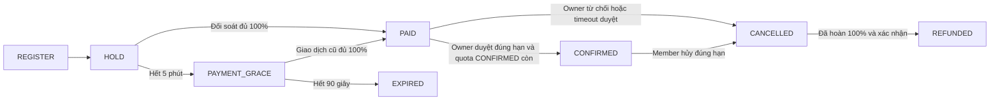
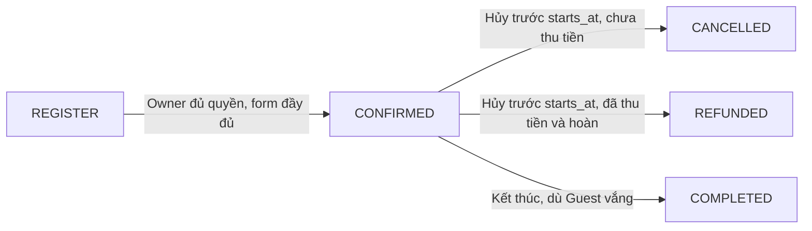

# ROLE–PERMISSION MATRIX — DatSan

**Phiên bản:** 3.0 — 16/11/2026  
**Trạng thái:** Đồng bộ BRC v3 và Booking State Machine v3. `OPEN-05` (chuyển Admin khi Owner chốt trễ) còn ở trạng thái đề xuất do yêu cầu có dấu hỏi.  
**Nguồn:** `mo-ta-du-an.md`, Role–Permission Matrix v2.0 và các quyết định OPEN mới nhất.

> **Phân biệt vai trò với trạng thái Booking:** Một actor có quyền thực hiện Use Case không có nghĩa được chuyển trạng thái bất kỳ. Backend phải kiểm tra **Owner của Venue, booking_type, booking.status, starts_at/ends_at và deadline**. Không có quyền thu cọc hoặc xác nhận tiền mặt còn lại trong Member Booking: Member chuyển khoản **100% hóa đơn** trước `PAID`.

## 1. Danh sách Actor và kế thừa

| Actor | Loại | Trách nhiệm |
|---|---|---|
| `Guest` | Người truy cập chưa đăng nhập | Xem công khai; cung cấp dữ liệu để Owner đặt sân hộ ngoài luồng tự phục vụ. |
| `Member` | Người dùng đã đăng ký | Tìm sân, tạo Member Booking, chuyển khoản đủ 100%, hủy đúng hạn, xem lịch sử, đánh giá. |
| `Owner` | Member được cấp thêm quyền sau khi duyệt hồ sơ | Kế thừa mọi quyền Member; quản lý **tối đa 01 Venue**; tạo Owner–Guest Booking; duyệt/hủy/chốt đơn thuộc Venue của mình. |
| `Administrator` | Quản trị hệ thống | Duyệt Owner, quản lý nội dung/tài khoản, tiếp nhận khiếu nại, xử lý Refund quá SLA. |
| `Payment Gateway` | **External Actor** | Trả dữ liệu giao dịch chuyển khoản, callback/webhook, đối soát; không duyệt Booking. |

**UML generalization:** `Owner --|> Member` (Owner kế thừa Member). Payment Gateway nằm **ngoài system boundary**. DatSan Scheduler là thành phần nội bộ, không là external actor.

## 2. Quy ước phân quyền

- `✓`: có quyền trong phạm vi quy định.
- `—`: không có quyền.
- `*`: có quyền **kèm guard** (về hạn, trạng thái, Venue, loại đơn hoặc dữ liệu).
- Bảng sau là **quyền truy cập nghiệp vụ**, không trao quyền sửa trực tiếp Booking status/database.

## 3. Role–Permission Matrix

### 3.1. Tài khoản và tìm sân

| Chức năng | Guest | Member | Owner | Admin |
|---|:---:|:---:|:---:|:---:|
| Xem nội dung công khai, khuyến mãi, thông báo | ✓ | ✓ | ✓ | ✓ |
| Tìm/lọc sân, xem bản đồ, thông tin Venue | ✓ | ✓ | ✓ | ✓ |
| Xem cập nhật chi tiết lịch trống/slot | — | ✓ | ✓ | — |
| Đăng ký tài khoản Member | ✓ | — | — | — |
| Đăng nhập bằng tài khoản hợp lệ | * | ✓ | ✓ | ✓ |
| Xem/sửa thông tin cá nhân | — | ✓ | ✓ | * |
| Nộp hồ sơ xin quyền Owner | — | ✓ | — | — |

`*` ở Guest/đăng nhập: Guest có thể xem form đăng nhập nhưng chỉ có quyền Member sau khi xác thực. `*` ở Admin/hồ sơ: chưa tự cấp quyền xem/sửa mọi dữ liệu nhạy cảm của Member.

### 3.2. Booking và thanh toán

| Chức năng | Guest | Member | Owner | Admin |
|---|:---:|:---:|:---:|:---:|
| Tạo Booking tự phục vụ tại Court có thể đặt | — | ✓ | ✓ | — |
| Chọn tối đa một mã giảm giá hợp lệ | — | ✓ | ✓ | — |
| Chuyển khoản **100% hóa đơn** khi tự đặt | — | ✓ | ✓ | — |
| Xem lịch sử Booking cá nhân | — | ✓ | ✓ | — |
| Hủy Member Booking ở `PAID/CONFIRMED` trước `starts_at` ít nhất 12h | — | * | * | — |
| Nhận/xác nhận khoản hoàn cho Member Booking | — | * | * | — |
| Đánh giá Court sau `COMPLETED` của Member | — | * | * | — |
| **Tạo Booking hộ Guest** tại Venue mình | — | — | * | — |
| **Lập hóa đơn Owner–Guest như Booking thường** | — | — | * | — |
| **Ghi Guest: họ tên, ngày sinh, số điện thoại** | — | — | * | — |
| Ghi nhận tiền thực thu cho Owner–Guest | — | — | * | — |
| Duyệt `PAID → CONFIRMED` của Member Booking | — | — | * | — |
| Từ chối `PAID` hoặc hủy Member Booking tại Venue | — | — | * | — |
| Hủy Owner–Guest **chưa thu tiền** trước `starts_at` → `CANCELLED` | — | — | * | — |
| Hủy Owner–Guest **đã thu tiền** trước `starts_at` → **`REFUNDED` trực tiếp** | — | — | * | — |
| Chốt Member Booking `COMPLETED/NO_SHOW` trong 24h sau `ends_at` | — | — | * | — |
| Chốt Owner–Guest `COMPLETED` dù Guest không đến | — | — | * | — |
| Theo dõi tiến độ hoàn tiền tại Venue mình | — | — | ✓ | * |

**Ghi chú:**

1. Owner tự đặt sân với tư cách Member phải **chuyển khoản đủ 100% hóa đơn**; không được dùng quyền đặt hộ để bỏ thanh toán cho Booking của chính mình.
2. Owner đặt hộ Guest đi trực tiếp `REGISTER → CONFIRMED`. Việc Owner có thể ghi nhận **thực thu 0** không khiến hóa đơn miễn phí; `booking_total` vẫn được tính bình thường.
3. Owner hủy Owner–Guest **không được thực hiện từ thời điểm `starts_at` trở đi** (`now < starts_at`). Đây là quyền đặc thù, không đồng nhất với khả năng Owner hủy Member Booking ở trạng thái cho phép.
4. Owner–Guest **đã thu tiền**: Owner chịu toàn bộ chi phí/rủi ro khi hủy và thực hiện `CONFIRMED → REFUNDED` trực tiếp; quyền này không áp dụng cho Member Booking.
5. `CONFIRMED → REFUNDED` cần dữ liệu khoản đã hoàn để không đánh dấu sai kết quả nghiệp vụ; Owner–Guest không yêu cầu Guest có tài khoản Member để bấm xác nhận nhận hoàn.
6. Chỉ **hai Member Booking đang `CONFIRMED`** được tính theo **ngày tạo Booking**. Owner duyệt Member Booking phải kiểm tra quota; `PAID`, `CANCELLED`, `REFUNDED` không tính. Theo cách hiểu “chỉ tính CONFIRMED”, trạng thái `COMPLETED/NO_SHOW` cũng không tính vào hạn mức trạng thái hiện tại.
7. **Không** có chức năng Owner xác nhận thu thêm tiền mặt/số dư đối với Member Booking, vì Member đã trả 100% từ trước.

### 3.3. Quản lý Venue (Owner chỉ quản lý Venue của mình)

| Chức năng | Guest | Member | Owner | Admin |
|---|:---:|:---:|:---:|:---:|
| Mở Dashboard chủ sân | — | — | ✓ | — |
| Thêm/chỉnh sửa Venue, Court, thông tin và giá sân | — | — | ✓ | — |
| Thiết lập giờ hoạt động, chặn giờ bảo trì | — | — | ✓ | — |
| Ẩn sân ngừng hoạt động | — | — | ✓ | — |
| Xem danh sách và lịch sử Booking tại Venue mình | — | — | ✓ | — |
| Quản lý blacklist Member ở Venue | — | — | ✓ | — |
| Đăng ký mã giảm giá chờ duyệt | — | — | ✓ | — |
| Gửi thông báo/khuyến mãi chờ Admin duyệt | — | — | ✓ | — |
| Xem doanh thu, tiền thực nhận và phí hoa hồng | — | — | ✓ | — |

### 3.4. Quản trị / giám sát

| Chức năng | Guest | Member | Owner | Admin |
|---|:---:|:---:|:---:|:---:|
| Gửi báo cáo/khiếu nại | — | ✓ | ✓ | — |
| Duyệt/từ chối hồ sơ Owner | — | — | — | ✓ |
| Khóa/mở tài khoản | — | — | — | ✓ |
| Xử lý báo cáo và tranh chấp | — | — | — | ✓ |
| Duyệt khuyến mãi/thông báo Owner | — | — | — | ✓ |
| Nhận xử lý Refund quá hạn 12h/24h | — | — | — | ✓ |
| Giải quyết Refund quá hạn trong 48h từ escalation | — | — | — | ✓ |
| Cấu hình hệ thống | — | — | — | ✓ |
| **Nhận vụ việc Owner không chốt kết quả trong 24h** | — | — | — | **?** |
| **Chốt `COMPLETED/NO_SHOW` thay Owner** | — | — | — | **—** |

`?`: OPEN-05 đang ở dạng **đề xuất** (“quá hạn thì chuyển lên Admin?”). Chưa chốt quyền Admin tiếp nhận; **không** tự cấp quyền chốt thay Owner, vì việc này chưa từng được quyết định.

## 4. Payment Gateway: external actor

| Tương tác | Payment Gateway | Hạn chế |
|---|:---:|---|
| Hỗ trợ dữ liệu QR/giao dịch chuyển khoản | * | Tùy cấu hình; **không** tạo QR/giao dịch mới trong PAYMENT_GRACE. |
| Cung cấp xác nhận chuyển khoản đủ 100% | ✓ | DatSan backend kiểm tra đủ tiền và deadline trước khi vào `PAID`. |
| Callback/webhook và đối soát giao dịch | ✓ | Xử lý idempotency; không tự duyệt Booking. |
| Duyệt Member Booking | — | Chỉ Owner được duyệt. |
| Tạo Owner–Guest Booking | — | Chỉ Owner có quyền tại Venue mình. |
| Thay đổi trực tiếp Booking status | — | Chỉ backend DatSan thay đổi sau kiểm tra guard. |

## 5. Các luồng nghiệp vụ dùng để thiết kế Use Case

### 5.1. Member tự đặt sân

- `approval_deadline = min(paid_at + 24h, starts_at - 2h)`.
- Timeout duyệt tạo Refund **12h**, tương tự trường hợp Owner từ chối.
- Member hủy hợp lệ khi còn ít nhất 12h: hoàn **100% số đã chuyển**, SLA **24h**.
- `PAID` chỉ là đã trả tiền, **chưa chiếm** hạn mức 2 `CONFIRMED` theo ngày tạo; quota kiểm tra khi Owner duyệt.

### 5.2. Owner đặt sân hộ Guest

- Form phải có **họ tên Guest, ngày sinh, số điện thoại**, cùng thông tin Court, giờ chơi, giá, ưu đãi và hóa đơn như thông thường.
- Bỏ bước thanh toán tại thời điểm tạo, nhưng **không bỏ hóa đơn** và **không tự coi tiền đã thu**.
- Owner chịu nghĩa vụ và rủi ro hoàn trả nếu hủy Booking đã thu tiền.
- Slot được mở lại ngay khi Booking chuyển `CANCELLED` hoặc `REFUNDED`.

## 6. Business Rules liên quan trực tiếp tới phân quyền

| ID | Rule/Guard |
|---|---|
| BR-ROLE-01 | Owner là Member được Admin duyệt thêm quyền. |
| BR-ROLE-02 | Mỗi Owner quản lý tối đa 01 Venue; chỉ thao tác trong Venue của mình. |
| BR-ROLE-03 | Owner tạo hộ Guest không cần Guest đăng ký, nhưng Guest phải có họ tên/ngày sinh/số điện thoại. |
| BR-ROLE-04 | Owner–Guest đi `REGISTER → CONFIRMED`, có hóa đơn như đơn bình thường, không phải thanh toán trước. |
| BR-ROLE-05 | Member (bao gồm Owner ở vai trò Member) chuyển khoản đủ 100% hóa đơn, không cọc. |
| BR-ROLE-06 | Owner duyệt Member Booking chỉ khi `PAID`, chưa quá hạn và quota `CONFIRMED` của ngày tạo còn. |
| BR-ROLE-07 | Member hủy hợp lệ trước `starts_at` ≥12h, Refund 100% tiền chuyển trong 24h. |
| BR-ROLE-08 | Owner hủy Member Booking tại Venue theo trạng thái hợp lệ; Refund 12h. |
| BR-ROLE-09 | Owner–Guest: Owner chỉ được hủy **trước starts_at**. |
| BR-ROLE-10 | Owner–Guest đã thu tiền: Owner hủy → `CONFIRMED → REFUNDED` trực tiếp; Owner chịu chi phí/rủi ro. |
| BR-ROLE-11 | Owner–Guest chưa thu tiền: Owner hủy → `CONFIRMED → CANCELLED`. |
| BR-ROLE-12 | Owner–Guest vắng vẫn `COMPLETED`, phí 30% **thực thu**, không phải 30% tổng hóa đơn mặc định. |
| BR-ROLE-13 | Hết hạn duyệt Member Booking đang PAID: hệ thống hủy, Refund theo SLA 12h của Owner. |
| BR-ROLE-14 | Owner phải chốt kết quả trong 24h sau ends_at; việc chuyển Admin quá hạn đang **chờ xác nhận OPEN-05**. |

## 7. Các điểm chưa chốt hết

| Mã | Vấn đề | Trạng thái |
|---|---|---|
| OPEN-05 | Cơ chế gửi nhắc Owner trong cửa sổ 24h là định hướng đã nêu; việc **tự chuyển Admin sau hạn** là câu hỏi/chưa xác nhận. Admin chưa có quyền chốt thay Owner. | Chờ xác nhận |
| OPEN-09 | Tiêu chuẩn timestamp đối soát giao dịch sát hạn HOLD/grace. | Kỹ thuật chưa chốt |
| Phân quyền thu hồi Owner | Admin có thể chỉ gỡ quyền Owner mà giữ Member và xử lý các đơn đang mở thế nào? | Chi tiết ngoài các OPEN vừa chốt |
| Ngoại lệ quota | Nếu quá nhiều Booking PAID cùng chờ duyệt làm quota CONFIRMED đầy, cách trả tiền/ từ chối thao tác không thể suy ra từ Role Matrix. | Cần đặc tả exception flow |
| Chứng cứ thực thu/hoàn Guest | Cách xác minh khoản Owner đã thu và đã hoàn, ảnh hưởng đối soát hoa hồng. | Chi tiết triển khai |

## 8. Gợi ý cho Use Case Diagram

- Actor cấp cao: `Guest`, `Member`, `Owner`, `Administrator`, `Payment Gateway` (external). `Owner --|> Member`.
- Tách `Đặt sân trực tuyến`, `Thanh toán chuyển khoản 100%`, `Owner đặt hộ Guest`, `Duyệt Booking`, `Quản lý hủy/Refund`, `Chốt kết quả`.
- Trong Use Case `Owner đặt hộ Guest`, phân tách hai nhánh hủy: chưa thu tiền `→ CANCELLED`; đã thu tiền `→ REFUNDED`.
- Phân quyền Admin chỉ thể hiện các năng lực đã chốt; **không** vẽ quyền chốt kết quả thay Owner chỉ vì có escalation đề xuất.

**Tài liệu đồng bộ:** `Business-Rules-Catalog-DatSan-v3.md` · `Booking-State-Machine-DatSan-v3.md`.
