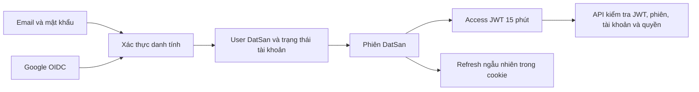
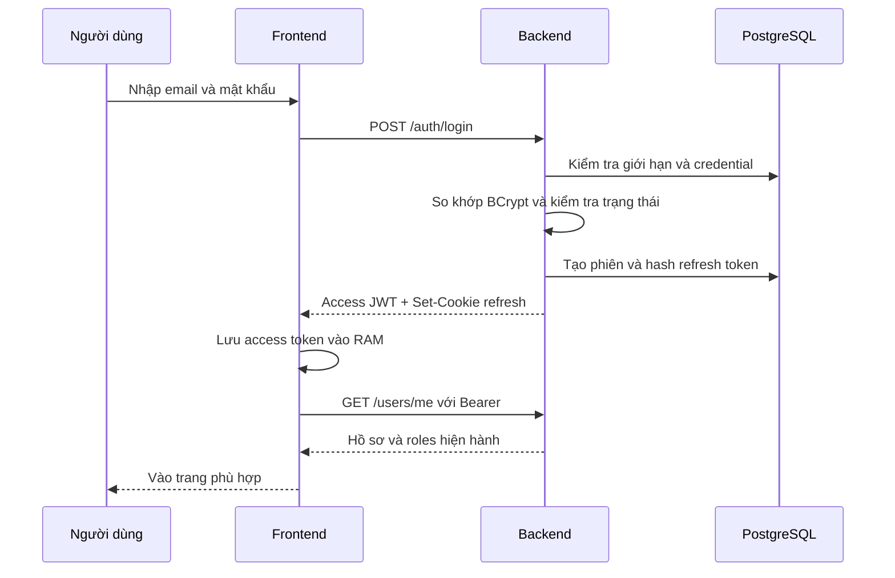
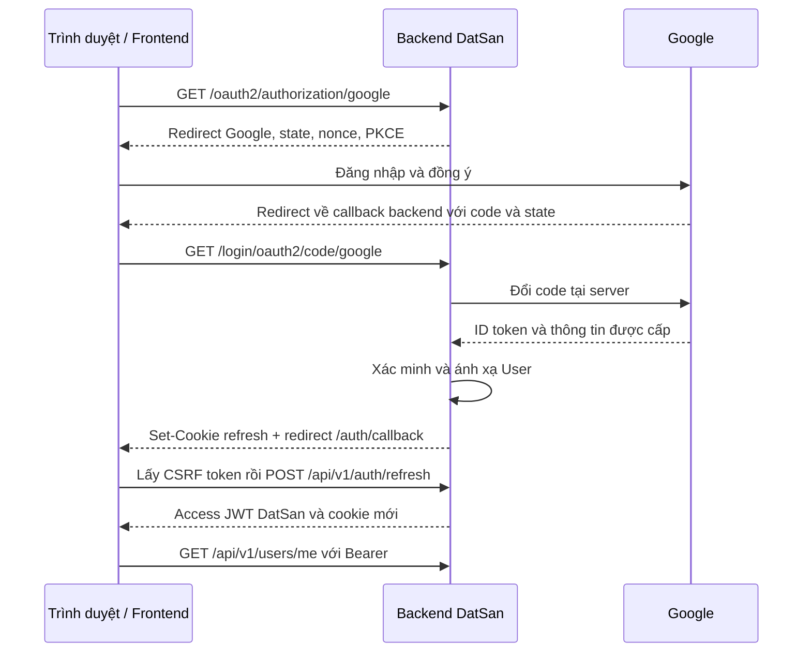

# Thiết kế đăng ký, đăng nhập JWT và Google OAuth2

Ngày: 01/10/2026. Phạm vi: thiết kế logic, chưa triển khai mã nguồn.

Tài liệu này cụ thể hóa F01–F05, F81, UC01, UC02, UC11 và Q01/Q02/Q13/Q14/Q17 của `use-case-api.md`. Các lựa chọn bổ sung dưới đây là **đề xuất thiết kế**, chưa phải quyết định đã được nhóm duyệt. Không thay đổi yêu cầu bắt buộc trong `dac-ta-chuc-nang.md`.

## 1. Cơ sở và hiện trạng đã đọc

- `docs/dac-ta-chuc-nang.md`: xác thực email, BCrypt, access 15 phút, refresh 7 ngày, 5 lần sai mật khẩu khóa tạm 15 phút; reset một lần trong 15 phút; backend kiểm soát quyền.
- `docs/use-case-api.md`: link xác thực 24 giờ, tập vai trò, cookie refresh có rotation, cùng origin, hợp đồng endpoint/DTO/lỗi, module sở hữu dữ liệu. Qxx vẫn là đề xuất.
- `docs/ke-hoach-do-an-dat-san-java.md`: phân công TV5 auth/user, TV3 email, TV4 admin, TV2 phối hợp ERD/migration.
- `backend/pom.xml`: Java 21, khai báo Spring Boot 4.1.1; có Security, OAuth2 Client, Resource Server, JPA, Validation, Flyway. Chưa thấy dependency Mail hoặc Bucket4j trong pom đã đọc. Đây là hiện trạng file, chưa kiểm chứng build/phân giải dependency.
- Backend hiện có application và nhóm exception; chưa có User, auth service, SecurityFilterChain hay migration auth trong cây `backend/src` đã kiểm tra.
- Frontend đã có access token trong bộ nhớ, Axios refresh có gộp request trong một tab, session store, login/logout, route guard, MSW và Vite proxy. Đăng ký còn là trang tạm; chưa có route callback OAuth2.

Các điểm phải xử lý khi bước sang code:

| Hiện trạng | Ảnh hưởng và hướng xử lý |
|---|---|
| Application ở `vn.datsan.backend`, exception ở `vn.datsan.common.exception` | Với cấu hình hiện tại, quét component mặc định không bao phủ package exception. Đề xuất đặt application tại gốc `vn.datsan`; đồng bộ cả test, entity và repository scan |
| `ErrorResponse.timeStamp` | Không khớp `timestamp` ở tài liệu và TypeScript; thống nhất `timestamp` |
| Handler validation trả `Validation_Failed` | Thống nhất `VALIDATION_FAILED` |
| Lỗi bất ngờ trả `INTERNAL_SERVER_ERROR` | Hợp đồng đang dùng `INTERNAL_ERROR`; chọn hợp đồng làm chuẩn |
| Handler mới có validation, business validation, not found và catch-all | Cần ánh xạ auth/permission/parsing/rate limit riêng; tránh lỗi dự kiến thành 500 |
| Login gọi `signIn(accessToken, await getMe())` | `getMe()` chạy trước khi token mới được lưu; có thể gây 401 và refresh thừa. Luồng đúng: lưu token → getMe → cập nhật session; thất bại thì dọn trạng thái phù hợp |
| Mock `/users/me` dựa vào cờ session | Có thể che lỗi thiếu Bearer; nghiệm thu cần backend thật |
| Q14 chọn frontend `/oauth2/callback`, Vite proxy toàn bộ `/oauth2` | Callback bị chuyển sang backend; đề xuất frontend `/auth/callback`, giữ route Google của backend như hiện tại |
| PWA loại `/oauth2/*` khỏi navigation fallback | Khi đổi callback phải đồng bộ router/proxy/PWA; callback SPA cần tải được khi mở trực tiếp, response token không được cache |
| Bootstrap/refresh bắt mọi lỗi thành anonymous | Cần phân biệt phiên hết hạn với mất mạng/503; không kết luận người dùng bị logout chỉ vì backend tạm thời lỗi |

## 2. Kiến trúc và các quyết định đề xuất

Hai cách đăng nhập cùng tạo một phiên DatSan và cùng dùng một cơ chế phân quyền:

| Chủ đề | Phương án đề xuất |
|---|---|
| Access token | JWT do backend DatSan ký; 900 giây; gửi `Authorization: Bearer`; frontend chỉ giữ trong RAM |
| Refresh token | Chuỗi ngẫu nhiên đủ mạnh, ví dụ 32 byte từ CSPRNG; không cần là JWT; server lưu hash SHA-256, không lưu plaintext |
| Thời hạn phiên | Tối đa 7 ngày tính từ lần đăng nhập; rotation không kéo dài vô hạn. Cookie/token mới chỉ còn thời gian đến hạn gốc |
| JWT claims | `iss`, `aud`, `sub` là UUID User, `sid` là phiên, `iat`, `exp`, `jti`; không chứa password, token Google, điện thoại hay giấy tờ |
| Ký JWT | Đề xuất RS256, private key ở backend/secret store; verifier cố định thuật toán, issuer, audience; có `kid` để thay khóa. Không sinh lại khóa mỗi lần khởi động |
| Quyền hiện hành | Đọc roles, emailVerified và trạng thái User từ DB ở request được bảo vệ; JWT không là nguồn duy nhất cho quyền |
| Thu hồi tức thời | Kiểm tra `sid` còn hiệu lực và User không bị khóa ở mỗi request được bảo vệ. Chấp nhận truy vấn DB để đơn giản và đáp ứng UC11 (khóa tài khoản) |
| Chưa xác thực email | Cho đăng nhập và xem/sửa hồ sơ; không được tạo đơn hoặc nộp hồ sơ OWNER. Phần chặn nộp OWNER là đề xuất bổ sung |
| Vai trò mới | Luôn PLAYER; OWNER chỉ được thêm sau duyệt, giữ PLAYER; ADMIN cấp qua quy trình nội bộ |
| Deploy | Cùng origin qua reverse proxy; dev qua Vite. Không cần CORS cho đường gọi này |
| Google | Authorization Code + OpenID Connect, scope `openid email profile`; backend xử lý callback và phát phiên DatSan |

API xác thực bằng Bearer, không dùng HTTP session như một cách đăng nhập API thứ hai. Tuy vậy vẫn có dữ liệu phiên/revocation trong DB và trạng thái tạm phục vụ OAuth2. Đây không phải thiết kế hoàn toàn không lưu trạng thái.

## 3. Mô hình dữ liệu logic

Tên bảng là gợi ý để TV2/TV5 thống nhất ERD, chưa phải migration.

| Dữ liệu | Trường/ràng buộc chính |
|---|---|
| `users` | UUID, fullName, email, normalizedEmail UNIQUE, phone nullable cho Google, avatar, emailVerifiedAt nullable, status ACTIVE/LOCKED, timestamps |
| `user_roles` | userId + role UNIQUE; roles không lấy từ DTO đăng ký hoặc claims Google |
| `password_credentials` | userId UNIQUE, passwordHash, passwordChangedAt; không có dòng này nghĩa là chưa có mật khẩu local |
| `oauth_identities` | userId, provider GOOGLE, issuer, subject, providerEmail; UNIQUE(provider, issuer, subject), đề xuất UNIQUE(userId, provider) |
| `auth_sessions` | UUID sid, userId, createdAt, expiresAt, revokedAt, revokeReason; một phiên là một họ refresh token |
| `refresh_tokens` | tokenHash UNIQUE, sessionId, createdAt, expiresAt, consumedAt, replacedById; giữ lịch sử đã dùng để phát hiện reuse |
| `one_time_tokens` | tokenHash UNIQUE, userId, purpose VERIFY_EMAIL/RESET_PASSWORD, targetEmail khi cần, expiresAt, consumedAt |
| `login_attempts` | Khóa theo email đã chuẩn hóa, failedCount, lockedUntil; cập nhật nguyên tử, áp dụng cả email không tồn tại, có TTL dọn dữ liệu |
| Audit | login thành công/thất bại có giới hạn, refresh reuse, logout, reset, link Google, khóa/mở khóa, thay quyền; không lưu bí mật |

Tách `status=LOCKED` do admin khỏi `lockedUntil` do sai mật khẩu. Email chưa xác thực cũng là trạng thái riêng, không đồng nhất với admin khóa.

Chính sách dữ liệu đề xuất:

- Email trim và lowercase nhất quán theo chính sách ứng dụng; không tự bỏ dấu chấm hoặc phần `+tag` của Gmail. UNIQUE trên giá trị chuẩn hóa, không chỉ kiểm tra trước bằng truy vấn.
- Mật khẩu tối thiểu 8 ký tự theo F01 và tối đa 72 byte UTF-8 cho BCrypt; không trim, không cắt ngầm; frontend/backend phải thống nhất cách đếm. Cost BCrypt chọn bằng đo thời gian trên máy deploy.
- Phone chuẩn hóa dạng quốc tế; chưa có yêu cầu phone duy nhất hoặc xác thực SMS nên không dùng phone làm khóa danh tính.
- Token một lần và refresh có entropy cao nên hash SHA-256 phù hợp; mật khẩu người dùng dùng BCrypt.
- Hạn dùng kiểm tra ngay trong transaction: `now >= expiresAt` là hết hạn, không phụ thuộc job dọn dữ liệu.

## 4. Đăng ký bằng email và xác thực email

1. Frontend gửi `fullName, email, phone, password` đến `POST /api/v1/auth/register`; không gửi roles/status/userId.
2. Backend validate, chuẩn hóa email/phone, áp dụng rate limit, hash password.
3. Trong transaction tạo User ACTIVE nhưng chưa xác thực email, credential và PLAYER; tạo token VERIFY_EMAIL hạn 24 giờ.
4. Commit rồi gửi email. Đề xuất lưu tác vụ gửi có retry bền vững cùng transaction; payload chứa link phải được bảo vệ và xóa sớm, không ghi log.
5. Trả 201 với trạng thái chờ xác thực, không tự cấp phiên. Trang hiển thị hướng dẫn kiểm tra email và nút gửi lại.
6. Người dùng mở link tới frontend `/verify-email`; mở trang bằng GET không tiêu thụ token. Người dùng xác nhận để frontend POST `{token}` đến `/auth/email-verifications`.
7. Backend kiểm tra hash, purpose, hạn, chưa dùng và email đích còn phù hợp; cập nhật emailVerifiedAt và consumedAt nguyên tử. Trả 204, dẫn sang đăng nhập hoặc tải lại `/users/me` nếu đã có phiên.

Các nhánh lỗi và retry:

- Email đã tồn tại: 409 `EMAIL_ALREADY_EXISTS` theo hợp đồng hiện tại; không ghi đè tài khoản cũ dù chưa xác thực. Đây là điểm chấp nhận lộ sự tồn tại email ở đăng ký; nếu nhóm muốn chống dò email tại đây thì đổi toàn bộ hợp đồng sang phản hồi trung tính.
- Hai đăng ký cùng email: unique DB quyết định một tài khoản; chuyển lỗi constraint đã nhận diện thành 409, không map mọi lỗi DB thành email trùng.
- Gửi lại link: POST `/auth/email-verification-requests` với email, trả 202 cùng thông báo dù email không tồn tại/đã xác thực; cooldown gợi ý 60 giây kèm hạn theo giờ/IP. Chỉ một token VERIFY_EMAIL đang hiệu lực; phát token mới thì vô hiệu token cũ nguyên tử.
- Link sai, hết hạn hoặc dùng lại: 400 `EMAIL_VERIFICATION_TOKEN_INVALID`; hướng dẫn gửi lại, không tạo phiên từ link.
- Email gửi thất bại sau commit: tài khoản vẫn tồn tại; retry tác vụ hoặc gửi lại. Không trả tình trạng khiến frontend tưởng đăng ký chưa từng được ghi nhận.
- Trang chứa token không tải analytics/tài nguyên bên thứ ba; dùng Referrer-Policy `no-referrer`, bỏ token khỏi thanh địa chỉ sau khi đọc và không log query. Có thể đặt token trong fragment của link frontend để không gửi lên HTTP server qua URL.

## 5. Đăng nhập bằng email/mật khẩu

Quy tắc xử lý:

1. Áp dụng rate limit IP và email chuẩn hóa trước tác vụ BCrypt; không chỉ khóa theo IP.
2. Khi đang khóa tạm: 429 `LOGIN_TEMPORARILY_LOCKED`, `Retry-After` là số giây còn lại; không kéo dài thời hạn chỉ vì có thêm request trong lúc khóa.
3. Email không tồn tại hoặc không có credential local: kiểm tra với dummy hash để giảm khác biệt thời gian và trả cùng lỗi như mật khẩu sai.
4. Sai lần 1–4 trả 401 `INVALID_CREDENTIALS`; lần 5 đặt lockedUntil = now + 15 phút và trả 429. Hết hạn mở chu kỳ đếm mới. Đếm đồng thời phải nguyên tử và không bị rollback cùng exception nghiệp vụ.
5. Mật khẩu đúng, User ACTIVE, không bị khóa tạm: reset bộ đếm và tạo phiên. Admin khóa thì không tạo phiên; phản hồi đăng nhập trung tính `INVALID_CREDENTIALS` để phù hợp quy ước chống dò trạng thái.
6. Thành công trả `{accessToken, tokenType: "Bearer", expiresIn: 900}`, cookie refresh; header `Cache-Control: no-store`.
7. Frontend lấy `/users/me`, giữ trang đích nội bộ hợp lệ. Người có nhiều vai trò có thể đổi khu vực; không lấy một role đầu tiên làm quyền duy nhất.

Đề xuất khóa tạm chỉ áp dụng phương thức mật khẩu; Google đã xác minh vẫn được đăng nhập nếu User ACTIVE. Google không xóa khóa tạm của mật khẩu. Admin khóa chặn mọi phương thức và phiên cũ.

## 6. Đăng nhập/đăng ký Google

Google xác minh danh tính qua OpenID Connect; API DatSan dùng JWT do DatSan phát. Dùng subject ổn định của Google để nhận diện, không dùng email làm định danh liên kết. Các kiểm tra giao thức và ý nghĩa `sub` dựa trên [Google OpenID Connect](https://developers.google.com/identity/openid-connect/openid-connect).

Chi tiết triển khai logic:

- Dùng Spring Security OAuth2 Client xử lý giao thức; scope tối thiểu `openid email profile`. Không xin quyền Drive/Calendar hoặc offline access chỉ để đăng nhập.
- Tạo state, nonce và PKCE S256; lưu giao dịch OAuth2 gắn với trình duyệt, hạn gợi ý 5 phút, dùng một lần. Đề xuất HTTP session tạm riêng cho handshake; xóa trạng thái và hủy session tạm sau thành công/thất bại. API Bearer không chấp nhận session này thay JWT.
- Backend kiểm tra state gắn đúng trình duyệt, chữ ký ID token, issuer, audience/client ID, expiry, nonce và các claim liên quan theo thư viện; chỉ lấy dữ liệu đã xác minh. Client secret chỉ có ở backend.
- Không giả định cấu hình framework tự bật đủ PKCE/nonce theo mong muốn; kiểm tra request thực tế khi tích hợp. Khi nhiều replica, trạng thái handshake cần kho dùng chung hoặc routing phù hợp.
- Redirect URI đăng ký với Google là URL công khai `/login/oauth2/code/google`, không phải trang frontend `/auth/callback`. Dev dùng origin Vite `http://localhost:5173`; production dùng origin HTTPS. Proxy phải bảo toàn đúng public origin, chỉ tin forwarded headers từ proxy tin cậy.
- Google lỗi hoặc người dùng hủy: không tạo phiên; chuyển về trang login với mã an toàn như `OAUTH2_LOGIN_FAILED`/`OAUTH2_CANCELLED`, không kèm token, raw exception hoặc thông tin nhạy cảm.

Ánh xạ tài khoản sau khi Google hợp lệ:

| Trường hợp | Xử lý |
|---|---|
| Đã có `(provider, issuer, sub)` | Lấy User liên kết; kiểm tra ACTIVE rồi tạo phiên; không tự ghi đè email local nếu email Google thay đổi |
| Chưa liên kết, email mới và `email_verified=true` | Tạo User PLAYER, emailVerifiedAt, identity Google; không tạo mật khẩu giả |
| Chưa liên kết, email trùng User hiện có | Không tự nối tài khoản và không tạo User trùng; trả trạng thái cần liên kết, hướng dẫn đăng nhập tài khoản cũ trước |
| Thiếu email hoặc chưa được Google xác minh | Bản đầu từ chối tạo tài khoản và cho chọn đăng ký local; không bỏ qua yêu cầu xác thực |
| User bị admin khóa | Không tạo phiên dù Google thành công |

Không tự gộp chỉ dựa vào email, kể cả tài khoản local chưa xác thực. Nếu người dùng không đăng nhập được tài khoản local thì thực hiện reset email trước; không giữ lại credential do người khác có thể đã tạo khi gộp.

Liên kết Google là luồng riêng: đăng nhập tài khoản hiện tại → xác thực lại gần đây (đề xuất trong 5 phút) → backend tạo giao dịch link gắn userId và sid từ Bearer → Google → callback xác minh đúng giao dịch và phiên còn sống → thêm identity trong transaction. Không lấy userId từ query callback. Nếu Google identity đã thuộc người khác thì 409 `OAUTH2_IDENTITY_ALREADY_LINKED`; không chuyển chủ. Không triển khai unlink trong bản đầu.

Google thường không cung cấp phone trong scope này. Đề xuất cho đăng nhập trước, dẫn đến bổ sung phone/fullName nếu thiếu; chặn tạo đơn hoặc nộp hồ sơ OWNER cho đến khi đủ thông tin liên hệ. Quy tắc chặn này là bổ sung cần đưa vào hợp đồng booking/user; phone nhập vào chưa có nghĩa đã được xác thực SMS. Không cần mở rộng `/users/me` ngay: trang callback có thể lấy profile chi tiết, hoặc bổ sung `profileComplete` nếu cả nhóm thống nhất DTO.

## 7. Refresh, logout và hiệu lực JWT

Refresh rotation và phát hiện token đã dùng lại theo định hướng [RFC 9700, mục 4.14](https://www.rfc-editor.org/rfc/rfc9700.html#section-4.14). Thời hạn và xử lý retry dưới đây là chính sách riêng đề xuất cho DatSan.

1. Frontend POST `/auth/refresh` bằng cookie và CSRF header; không yêu cầu access token còn hạn.
2. Backend tìm token bằng hash; kiểm tra phiên, User, thời hạn và token chưa bị tiêu thụ.
3. Trong một transaction khóa/cập nhật có điều kiện token và phiên: đánh dấu token cũ đã dùng, tạo token mới cùng sid và cùng hạn cuối 7 ngày.
4. Commit, đặt cookie mới, trả access JWT mới. Hạn JWT không vượt quá hạn cuối phiên.
5. Token hết hạn/không có/không hợp lệ: 401 `INVALID_TOKEN` hoặc `TOKEN_EXPIRED` theo bảng lỗi; xóa cookie khi xác định phiên không dùng được.
6. Token đã consumed được gửi lại: thu hồi toàn bộ phiên/họ token đó, trả 401 `INVALID_TOKEN`, ghi audit. Không thu hồi các thiết bị khác chỉ vì một phiên reuse.

Token ngẫu nhiên không tìm thấy thì chỉ từ chối, không cho client tùy ý chỉ định session cần thu hồi. Giữ token consumed ít nhất đến hạn cuối phiên để nhận diện reuse.

Đồng thời và mất mạng:

- Gộp các refresh trong một tab như frontend hiện tại; bổ sung phối hợp giữa các tab bằng cơ chế khóa/chia sẻ kết quả phù hợp. Cookie dùng chung nên nhiều tab không được cùng rotate bằng token cũ.
- Bootstrap và trang callback dùng cùng một tác vụ khôi phục phiên, tránh hai request refresh liên tiếp do hai thành phần tự khởi chạy.
- Bản đầu chọn phát hiện reuse nghiêm ngặt: nếu refresh đã commit nhưng response mất, gửi lại token cũ có thể làm phiên bị thu hồi và phải đăng nhập lại. Không tự retry refresh như một POST thông thường. Đây là đánh đổi rõ ràng để tránh cơ chế grace/idempotency chứa thêm bí mật.
- 401 do access hết hạn có thể refresh rồi retry tối đa một lần; 403 thiếu quyền/email chưa xác thực không refresh. Không auto-refresh các API login/register/reset/logout/link auth.
- Mất mạng/503: hiển thị thử lại và giữ trạng thái lỗi tạm; không vô hạn refresh hoặc tự coi tài khoản đã bị khóa.

Logout hiện tại:

- POST `/auth/logout` xác thực cookie refresh và CSRF; không cần JWT còn hạn. Thu hồi sid, xóa cookie đúng name/path/domain, trả 204. Không có phiên vẫn trả 204.
- Token cũ thuộc phiên đã rotate vẫn có thể dùng để nhận diện phiên cần logout; luôn thu hồi trên server trước khi báo hoàn tất.
- Frontend xóa access, User, cache riêng tư, ngắt WebSocket và thông báo tab khác. Phải hủy/bỏ qua kết quả refresh/getMe đang bay để không đăng nhập lại sau logout.
- Nếu mạng lỗi, chỉ có thể khẳng định đã dọn phía client; chưa đảm bảo thu hồi server hoặc xóa HttpOnly cookie. UI cần cho thử lại, không tuyên bố đã kết thúc phiên server.
- Logout mọi thiết bị là endpoint mở rộng tùy chọn; reset/đổi mật khẩu và admin khóa phải có khả năng thu hồi mọi phiên ngay cả khi chưa có màn hình quản lý thiết bị.

Với kiểm tra sid/User mỗi request, JWT cũ bị từ chối ở request tiếp theo sau khi thu hồi commit. Request đã qua kiểm tra trước thời điểm khóa không thể tự bị quay ngược; thao tác nhạy cảm cần kiểm tra điều kiện trong transaction nghiệp vụ. WebSocket cần đóng kết nối khi logout/khóa/hết hạn và kiểm soát SUBSCRIBE/SEND; kiểm tra HTTP không tự thu hồi socket đang mở.

## 8. Cookie, CSRF và phân quyền

Cookie refresh đề xuất: host-only, `HttpOnly`, `Secure` ở HTTPS, `SameSite=Lax`, `Path=/api/v1/auth`, `Max-Age` bằng thời gian còn lại của phiên. Localhost HTTP có cấu hình riêng bỏ Secure; không dùng cấu hình đó cho production. Không set Domain rộng. Cookie session OAuth2 tạm có path đủ bao phủ cả route bắt đầu và callback, SameSite=Lax để dùng được khi Google redirect về.

Cookie tự gửi theo request nên cần CSRF; SameSite không thay thế toàn bộ kiểm tra này. Đề xuất `GET /api/v1/auth/csrf` để frontend lấy CSRF token, gửi qua header `X-XSRF-TOKEN` ở các POST auth; token CSRF không phải refresh token và có thể cho JavaScript đọc. Kiểm tra Origin với allowlist chính xác, fallback Referer hợp lệ khi cần; thiếu cả hai trên cookie-auth POST thì từ chối. Bootstrap lấy CSRF trước refresh; cần token mới sau thay đổi phiên theo vòng đời cấu hình. Cấu hình SPA phải theo [Spring Security CSRF](https://docs.spring.io/spring-security/reference/servlet/exploits/csrf.html).

Bearer API chỉ nhận token từ Authorization, không fallback cookie/session, có thể dùng chính sách CSRF riêng. OAuth2 callback dùng state/nonce và giao dịch handshake, không bắt buộc CSRF header từ Google. Webhook dùng xác thực riêng của provider; không vô hiệu CSRF toàn ứng dụng chỉ vì có JWT.

| Nhóm API | Điều kiện |
|---|---|
| Tìm sân, xem sân/lịch công khai | Không cần đăng nhập |
| Register/login/email/reset | Công khai có validation/rate limit và bảo vệ request theo loại; không yêu cầu JWT |
| Refresh/logout | Cookie hợp lệ theo nghiệp vụ, CSRF/Origin; logout không phiên là idempotent |
| `/users/me` | JWT + phiên hợp lệ + User ACTIVE |
| Tạo đơn | PLAYER + email đã xác thực + điều kiện booking; đề xuất thêm thông tin liên hệ đầy đủ |
| `/owner/**` | OWNER và đúng chủ sở hữu tài nguyên; không chỉ kiểm tra prefix |
| `/admin/**` | ADMIN và đúng hành động được cấp; không tự vượt kiểm tra sở hữu ở API khác |

Duyệt OWNER cập nhật roles trong DB; request tiếp theo dùng quyền hiện hành, frontend tải lại `/users/me`. Admin khóa: cập nhật User và thu hồi mọi phiên nguyên tử; mở khóa không khôi phục phiên cũ. Không có DTO public nào cho sửa roles/status/emailVerified.

## 9. Quên mật khẩu, đổi mật khẩu và tài khoản Google-only

- Yêu cầu reset: POST `/auth/password-reset-requests` với email, luôn 202 thông báo trung tính; rate limit/cooldown. Có credential local thì phát token 15 phút, dùng một lần; gửi email sau commit có retry.
- Trang reset mở bằng GET không tiêu thụ token. POST `/auth/password-resets` với token/newPassword: xác minh purpose/hash/hạn, đổi BCrypt hash, consume token, vô hiệu các reset token khác, thu hồi mọi phiên và reset khóa tạm trong transaction. Không mở khóa admin.
- Reset thành công trả 204, yêu cầu đăng nhập lại; không tự phát JWT. Đề xuất reset không tự đổi emailVerified; xác thực email vẫn có luồng riêng.
- Đổi mật khẩu khi đã đăng nhập: POST `/users/me/password-changes`, yêu cầu currentPassword/newPassword, kiểm tra mật khẩu hiện tại; thu hồi mọi phiên kể cả hiện tại, xóa phiên client và yêu cầu đăng nhập lại.
- Google-only: reset công khai không tự tạo credential local. Có thể gửi email hướng dẫn đăng nhập Google với cùng phản hồi 202. Nếu cần thêm mật khẩu, làm tính năng riêng trong hồ sơ, yêu cầu Google reauthentication gần đây và email đã xác thực; ngoài bản lõi đầu tiên.
- Tài khoản liên kết có cả Google và local: reset chỉ thay credential local, giữ identity Google; tất cả phiên DatSan cũ vẫn bị thu hồi.

## 10. Hợp đồng API đề xuất

Các path dưới đây có tiền tố `/api/v1`, trừ hai route Google đã mô tả. Thành công không bọc thêm lớp `data` để khớp frontend hiện tại.

| Method/path | Input / xác thực | Kết quả |
|---|---|---|
| POST `/auth/register` | fullName, email, phone, password | 201, trạng thái chờ xác thực, không token |
| POST `/auth/email-verification-requests` | email | 202 trung tính |
| POST `/auth/email-verifications` | token | 204 |
| POST `/auth/login` | email, password | 200 TokenResponse + cookie |
| GET `/auth/csrf` | Công khai, không cache | 200 CSRF token; endpoint bổ sung |
| POST `/auth/refresh` | Cookie + CSRF | 200 TokenResponse + cookie rotated |
| POST `/auth/logout` | Cookie + CSRF | 204 + xóa cookie |
| POST `/auth/password-reset-requests` | email | 202 trung tính |
| POST `/auth/password-resets` | token, newPassword | 204 |
| GET `/users/me` | Bearer | 200 theo Q17 |
| POST `/users/me/password-changes` | Bearer, currentPassword, newPassword | 204, thu hồi phiên |
| POST `/auth/google-link-requests` | Bearer + xác thực lại gần đây | 200 URL bắt đầu giao dịch link ngắn hạn; endpoint bổ sung |

URL link chỉ là yêu cầu OAuth2 được backend xây dựng, không chứa JWT/refresh/local userId làm bằng chứng. State gắn server-side với userId/sid và trình duyệt. Với link, tái xác thực local bằng mật khẩu hoặc Google hiện đã liên kết; chi tiết DTO xác thực lại cần ghi trong OpenAPI trước khi làm tính năng liên kết.

Các request thay đổi dữ liệu lấy CSRF token theo chính sách ở mục 8. Với TokenResponse giữ nguyên `{accessToken, tokenType, expiresIn}`. `/users/me` giữ `id, fullName, email, emailVerified, avatarUrl, roles`; bổ sung hồ sơ đầy đủ bằng hợp đồng riêng thay vì âm thầm đổi DTO.

## 11. Tích hợp GlobalExceptionHandler

Giữ một schema: `code, message, timestamp, path, traceId, errors`; `errors` luôn là mảng, code UPPER_SNAKE_CASE, path không có query chứa token. Không trả password/hash/token/raw Google error hoặc stack trace cho client.

| HTTP/code | Tình huống |
|---|---|
| 400 `VALIDATION_FAILED`, `INVALID_JSON` | Sai dữ liệu/cấu trúc |
| 400 `EMAIL_VERIFICATION_TOKEN_INVALID`, `PASSWORD_RESET_TOKEN_INVALID` | Token một lần sai/hết hạn/đã dùng; mã bổ sung |
| 401 `INVALID_CREDENTIALS` | Login thất bại trung tính |
| 401 `AUTHENTICATION_REQUIRED` | API cần Bearer nhưng thiếu |
| 401 `TOKEN_EXPIRED`, `INVALID_TOKEN` | JWT/refresh hết hạn, sai, phiên bị thu hồi; reuse trả mã chung và audit chi tiết nội bộ |
| 403 `EMAIL_NOT_VERIFIED` | Phiên hợp lệ nhưng chưa được tạo đơn |
| 403 `ACCESS_DENIED` | Thiếu quyền |
| 403 `ACCOUNT_LOCKED` | Request có danh tính đã xác minh nhưng User bị admin khóa; ưu tiên kiểm tra trạng thái này trước lỗi phiên revoked |
| 403 `CSRF_INVALID` | Thiếu/sai CSRF hoặc Origin không được phép; mã bổ sung |
| 409 `EMAIL_ALREADY_EXISTS` | Đăng ký trùng |
| 409 `OAUTH2_IDENTITY_ALREADY_LINKED` | Xung đột liên kết; mã bổ sung |
| 409 `PROFILE_INCOMPLETE` | Thiếu thông tin liên hệ khi tạo đơn/nộp OWNER; chỉ thêm nếu chọn quy tắc tương ứng |
| 429 `LOGIN_TEMPORARILY_LOCKED`, `RATE_LIMIT_EXCEEDED` | Có Retry-After |
| 500 `INTERNAL_ERROR` | Lỗi bất ngờ, thông báo chung |
| 503 `SERVICE_UNAVAILABLE` | Phụ thuộc cần thiết tạm lỗi; không biến thành sai mật khẩu |

Phân trách nhiệm:

- `GlobalExceptionHandler`: MVC/service, validation và exception nghiệp vụ auth có status/code cụ thể; không ép mọi lỗi auth thành `BusinessValidationException` 400.
- `AuthenticationEntryPoint`: lỗi xác thực ở security filter, JSON 401 và header Bearer phù hợp.
- `AccessDeniedHandler`: lỗi quyền/CSRF ở filter, JSON 403.
- Password login trong controller phải có ánh xạ authentication exception; không để catch-all biến sai mật khẩu thành 500.
- OAuth2 success/failure handler: redirect theo hợp đồng trình duyệt, không ép callback trả schema JSON API.
- Rate limit filter và các handler dùng chung bộ tạo/ghi response lỗi. Trace ID khởi tạo sớm trước security filter, trả cùng ID với log; không mỗi handler tự sinh một ID không liên kết.
- Log lỗi auth phải có kiểm soát tần suất và che thông tin nhạy cảm; catch-all hiện ghi toàn bộ exception cần rà để tránh thư viện đưa token/query vào log.

## 12. Phân chia công việc khi triển khai

| Phần | Trách nhiệm |
|---|---|
| `user` | User, roles, profile, trạng thái khóa, owner application; cung cấp thao tác nghiệp vụ cho auth/admin |
| `auth` | Credential, identity Google, session/token, JWT, refresh, reset, verify email, cấu hình security và OAuth2 handlers |
| `common` | Schema lỗi, trace ID, tiện ích thật sự dùng chung |
| `notification` | Vận chuyển email/template/retry; auth sở hữu mục đích và hạn token |
| `admin` | Điều phối duyệt OWNER/khóa User, gọi service có audit; không ghi tùy ý vào repository auth |
| Frontend `shared/api` | Bearer, refresh, CSRF và phát tín hiệu hết phiên; không import ngược `entities/session` |
| Frontend `entities/session`, `app` | Session state, điều phối bootstrap/logout, cập nhật cache, route guard và WebSocket |
| Frontend `features/auth`, `pages` | Form đăng ký/login/reset, xác thực email, callback, hướng dẫn bổ sung hồ sơ/link |

Thiết kế luồng gọi nội bộ để tránh vòng `auth ↔ user`: auth đọc tài khoản qua hợp đồng user; thao tác admin khóa cần một service điều phối transaction cập nhật User và thu hồi session. JWT request luôn kiểm tra User nên không có cửa sổ cho tài khoản khóa tiếp tục dùng phiên nếu phát sự kiện thu hồi chậm. Phối hợp numbering Flyway với TV2; chưa tạo migration trong giai đoạn này.

Thứ tự thực hiện sau khi thống nhất thiết kế: sửa nền package/error contract → ERD/OpenAPI → register/verify/login → JWT/session/refresh/logout → Google và nhánh trùng email → reset/đổi mật khẩu → tích hợp frontend, quyền và các kiểm thử bảo mật. Rate limit/CSRF đi cùng endpoint ngay từ đầu.

## 13. Tiêu chí kiểm chứng trước khi coi auth hoàn tất

1. Đăng ký hợp lệ/trùng/đồng thời, email khác hoa-thường, Unicode password quá 72 byte; không thể gửi roles để tự cấp OWNER/ADMIN.
2. Verify/reset đúng, sai purpose, hết hạn đúng biên, đã dùng, hai request đồng thời chỉ một request đổi dữ liệu; email retry sau lỗi không tạo tài khoản trùng.
3. Login sai 1–5 lần, mở lại sau 15 phút, đếm đồng thời, email không tồn tại và Google-only không lộ khác biệt phản hồi đáng kể.
4. JWT giả chữ ký, sai issuer/audience/algorithm, hết hạn, Google ID token dùng nhầm làm JWT DatSan đều bị từ chối.
5. Refresh rotation, reuse, hết 7 ngày, nhiều tab, response thất lạc; revoked token không khôi phục được phiên.
6. Logout/logout mạng lỗi/logout trong lúc refresh hoặc bootstrap chạy; token không bị ghi lại sau khi frontend đã kết thúc phiên.
7. Google mới/cũ/hủy/trùng email/thiếu verified email; state/nonce sai, replay callback, redirect không nằm allowlist và callback bị proxy sai.
8. Google trùng tài khoản chưa verify không tự gộp; link yêu cầu phiên và xác thực lại, identity không chuyển từ User khác.
9. Admin khóa chặn password, Google, refresh, JWT cũ và WebSocket; mở khóa không hồi sinh token cũ.
10. PLAYER chưa verify không tạo đơn; OWNER chỉ thao tác sân mình; duyệt OWNER giữ PLAYER và cập nhật quyền hiện hành.
11. Reset/đổi password thu hồi mọi phiên; Google-only không được tự tạo mật khẩu qua reset công khai.
12. MVC và security filter cùng schema lỗi; 401/403/429 đúng nghĩa; log/URL/cache không lộ token; CSRF giả và origin sai bị từ chối.
13. Chạy cả dev proxy và production HTTPS; bật/tắt mock đúng môi trường; reload trang callback hoạt động; phân biệt offline/503 với expired session.

Đây là danh sách nghiệm thu cho giai đoạn code. Chưa chạy test hoặc xác nhận luồng đã hoạt động trong tài liệu này.

## 14. Điểm cần nhóm thống nhất khi duyệt thiết kế

Phương án mặc định của bản này: cho login khi chưa verify nhưng chặn nghiệp vụ; phiên có hạn tuyệt đối 7 ngày; kiểm tra DB để thu hồi tức thời; Google trùng email phải link có xác thực lại; tài khoản Google thiếu phone bổ sung trước đặt sân; callback frontend đổi thành `/auth/callback`; refresh đồng thời/retry xử lý nghiêm ngặt; Google-only chưa có tính năng đặt mật khẩu local.

Cần đồng bộ các quyết định này với Q14, DTO/API và quy tắc booking trong `use-case-api.md` trước khi người khác viết code phụ thuộc. Hợp đồng chi tiết luồng link/xác thực lại là phần mở rộng cần đặc tả riêng nếu đưa vào đợt triển khai đầu. Nếu chưa làm link, nhánh trùng email phải từ chối an toàn và hướng dẫn dùng cách đăng nhập cũ, không auto-link tạm thời.

Tài liệu kỹ thuật đối chiếu: [Spring OAuth2 Login](https://docs.spring.io/spring-security/reference/servlet/oauth2/login/core.html), [Google OpenID Connect](https://developers.google.com/identity/openid-connect/openid-connect), [Spring CSRF](https://docs.spring.io/spring-security/reference/servlet/exploits/csrf.html), [RFC 9700](https://www.rfc-editor.org/rfc/rfc9700.html). Cần dùng API cấu hình tương ứng đúng phiên bản dependency thực tế khi triển khai; tài liệu này không cung cấp snippet code cấu hình.
